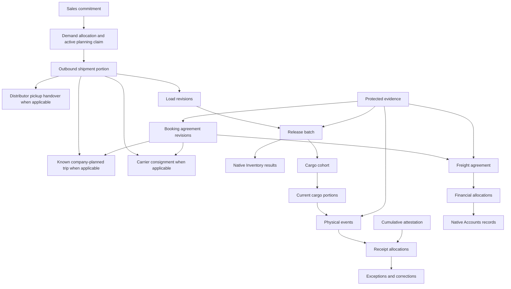

# Target Logistics Domain Model

## Modeling principles

The terms below are business distinctions, not a mandate for one database table or class per noun. Persist a distinction only when identity, authorization, history, reconciliation, or an invariant requires it. Reuse native records where ownership is correct; introduce Logistics records for transport coordination and facts the native domains do not own.

## Aggregate boundaries

| ID | Business record and responsible module | Owns | Must not own |
| --- | --- | --- | --- |
| D1 | Sales commitment (Sales) | Eligible source line, commercial quantity, source revisions, customer and order meaning. | Physical custody, freight payment, stock ledger. |
| D2 | Stock operation (Inventory) | Reservations, moves, Inventory balance records, issues, returns, corrections and native backorder lineage. | Booking, gate authority, receipt testimony, freight terms. |
| D3 | Logistics trip | Mode, Company, planned stops, assigned outbound shipment portions, booking references and current operational revision. | Source allocations, native demand or stock balances. |
| D4 | Booking agreement revision | Provider roles, contractual service boundary, commercial terms, acceptance, cancellation and superseded revisions. | Physical cargo acceptance, accounting liability or actual payment. |
| D5 | Load revision | Verified actual source lines, quantities, lots, packing, equipment, holds, measurements and provenance. | Physical departure or customer receipt. |
| D6 | Release batch | Frozen load/native operation set, approval scope, native outcomes, current gate authority. | Human waits, remote calls, future receipt. |
| D7 | Cargo cohort | Issued source identity and quantity carried into physical custody. | Mutable master definitions or accounting value. |
| D8 | Cargo portion | Effective nonoverlapping leaf, current custodian/uncertainty, location/segment, condition. | Another stock issue. |
| D9 | Physical event | One observed handover, arrival, refusal, damage, transfer, return or recovery occurrence. Reported missing goods remain observations until an authorized outcome is recorded. | Automatic commercial or financial truth, or an approved loss disposition. |
| D10 | Cumulative attestation | Scoped total confirmed through a cutoff, coverage links, prior allocation basis and verified difference. | Invented arrival, delivery attempt, or single physical event. |
| D11 | Receipt allocation | Authorized quantity allocation from event/attestation to dispatched cohort/outcome. | Quantity beyond identified dispatched scope. |
| D12 | Exception/correction case | Affected facts, owner, assignee, next action, age, dependencies, disposition. | Silent rewrite of original facts. |
| D13 | Freight agreement revision | Negotiated components, basis, supplier, service, terms, extras, responsibility. | Native payable, payment, reconciliation, bank balance. |
| D14 | Financial link and allocation | Link from a freight agreement to a native advance, bill, payment or reversal and its applied amount. | Parallel accounting residual. |
| D15 | Command result | Company/type/key, intent fingerprint, expected revision, actor context, canonical result/uncertainty. | Permission bypass on replay. |
| D16 | Approval authority | Scope, revision, approver, evidence, expiry/invalidation/consumption. | Indefinite or transferable authority. |
| D17 | Protected evidence | Private bytes, hash, size, detected type, provenance, access, retention, associations and lifecycle state. Accepted bytes remain immutable while retained. Approved disposal leaves an immutable tombstone. | Deletion ownership by general chatter attachments. |
| D18 | Operational control | Company activity status, effective cutoff, reason, actor and audit history. | Global bypass of ordinary permissions or owner invariants. |
| D19 | Outbound shipment portion | A company-, origin- and destination-specific quantity selected from source allocations for one factory departure, including commitment, recipient, packing and release lineage. | Stock posting, an invented trip, or an invented carrier movement. |
| D20 | Carrier consignment | Issuer-scoped reference, outbound shipment portions assigned to the consignment, separate physical handovers into carrier custody, contractual endpoint, known carrier milestones and optional known-trip links. Each assignment and handover records its actor, time and evidence and references the governing booking revision. | The booking agreement, accounting liability, or an invented internal itinerary. |

## Relationship model

## Identity rules

- Company identity is explicit on every Logistics root and is checked against every native reference.
- Native source IDs are preserved; copied descriptions are historical display snapshots, not replacement identities.
- Provider-issued consignment references are unique only within the approved issuer and service context; a consignment remains distinct from its booking agreement and any known physical trip.
- Demand allocation is the persisted planning record; an active claim is its quantity-consuming state, not a second allocation record.
- Request identity and physical-event identity are different. Multiple requests may report one event; equal events may carry equal quantities.
- A cumulative attestation has scope plus cutoff identity. It can cover several events and must reconcile with later event-level evidence.
- Payment idempotency is owned by Accounts at the financial effect boundary; Logistics command identity cannot substitute for it.
- Quant identity is owned by Inventory and includes every approved nullable dimension. NULL comparison semantics must be identical in application and database constraints.

## Quantity model

Every quantity carries:

- numeric value at approved precision;
- owning UoM and product;
- source and revision;
- conversion/breakdown and rounding rule when expressed in another unit;
- lot/package/owner/quality dimensions where required;
- provenance: master, measured, declared, inferred, legacy unknown, or corrected.

Do not use floating-point equality as a business invariant. Do not infer pouch/carton factors from a current mutable product record for historical work.

The following equation measures the outcome of the original outbound dispatch. It does not describe current custody or current saleable stock. Goods accepted and later returned remain counted as accepted for the original delivery and enter a separately linked reverse movement.

For each source cohort:

`original dispatched quantity = accepted by the intended commercial recipient + physically received at an approved return destination without prior acceptance + approved final non-delivery resolution + still outstanding`

Accepted-then-returned goods remain in `accepted_at_least_once` and gain linked return history. An unattributed physical observation is outside a cohort equation until an authorized allocation is made.

## Cargo invariants

- Effective current leaf portions sum to the original cohort quantity.
- A split retires the parent atomically and creates children whose content conserves the parent.
- When custody, location, condition or disposition differs for part of a cargo portion, split it into conserving child portions before recording the different current facts.
- One effective leaf has one identified custodian or an explicit custody-uncertain state.
- Transfers change custody/segment evidence; they do not issue Inventory again.
- Condition, custody, acceptance, and quality disposition are orthogonal.
- Loss and recovery are bounded, reversible dispositions, not destructive edits.

## Receipt invariants

- Observations are append-only testimony; verification and correction add linked facts.
- Canonicalization combines reports of one event without summing duplicates.
- Cumulative differences are recomputed under lock from current covered allocations.
- Event matching never relies only on date, quantity, or reporter.
- Overage and wrong-product evidence is retained but cannot consume an unrelated source.
- Commercial fulfillment changes only through an authorized allocation.

## Money invariants

- Freight agreement, liability, instruction, attempted execution, confirmed payment, allocation, hold, claim, and residual are separate.
- Logistics totals are explanatory views over approved agreement and native records; they are not accounting balances.
- A hold restricts authority but does not erase liability.
- An unknown external/manual outcome protects the amount from replacement until reconciled.
- Allocation and rounding conserve the native charge; unexplained remainder remains explicit.
- Supplier and recipient may differ, but both require approved identities and supporting evidence.

## Evidence and audit invariants

- Required bytes are durable before their association can make an action effective.
- While retention is required, a record must never point silently to missing or changed bytes. Approved disposal changes the evidence lifecycle to `disposed_per_retention_policy` and preserves the immutable hash, metadata, authorization, disposal time and tombstone. Any other missing or mismatched bytes are an incident.
- Corrections preserve original value, actor, time, and reason.
- Effective command results, approvals, operational-control history, accepted evidence associations and consequential corrections are append-only. Revocation or correction adds a linked record; ordinary and administrative application paths cannot delete the effective history.
- Printed/exported revisions identify their authority status; reprinting never renews authority.
- Audit entries capture business intent and result references without leaking protected data or secrets.

## Lifecycle separation

The following may progress independently and must never be collapsed into a single `completed` flag:

1. commercial demand and allocation;
2. booking/provider acceptance;
3. packing/loading readiness;
4. native stock issue;
5. Inventory issue and gate authority;
6. physical custody/departure;
7. receiving and source attribution;
8. exception/quality/return resolution;
9. freight liability/payment/allocation;
10. evidence and audit completeness.
