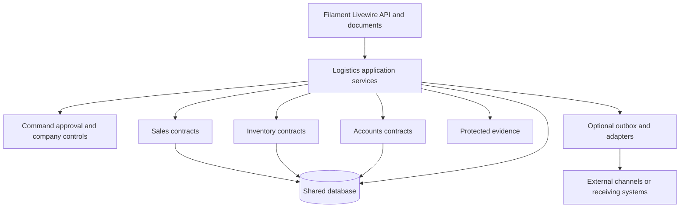

# Target Logistics Architecture

## Architectural position

Implement Logistics as a bounded module in the modular monolith, with explicit owner-local changes in native modules where the invariant belongs. Module boundaries follow business ownership, not convenience. Logistics may depend on stable native contracts; native modules must not import Logistics implementation classes.

## Key technical decisions

- KTD1. **Domain rules outrank legacy code.** Existing AureusERP services are reused only after their behavior is qualified against this pack. Incorrect ownership, atomicity, quantity, or accounting behavior is refactored in its owning module.
- KTD2. **Owner-local invariants.** Inventory owns stock operation, quant identity, reservation, return and correction invariants. Accounts owns financial execution, residual and reconciliation invariants. Logistics cannot repair these only in its callers.
- KTD3. **Shared transaction for local departure effects.** Native issue, backorder/remapping, claim consumption, release result, and critical event records for one departure commit or roll back on one proven connection.
- KTD4. **Deterministic shared writer protocol.** Discover the complete affected root set before mutation; lock roots in documented stable order; validate state under lock; retry the whole database-only command on a recognized deadlock.
- KTD5. **Enrolled execution guard.** Any native writer touching claimed or frozen Logistics cargo must supply the approved release context or fail. Unenrolled native work retains ordinary behavior.
- KTD6. **No generic saga for local work.** Local atomic work uses database transactions. Durable outbox/inbox records are introduced only for a real asynchronous or external effect that must survive a crash.
- KTD7. **Command idempotency is business-effect scoped.** Persist company, command type, key, significant payload fingerprint, expected revision, actor context, result and uncertainty. Externally supplied keys are unguessable, bind to the company, command, business root and significant intent, disclose no saved-result metadata to unauthorized/mismatched lookups, and have bounded retention and per-actor abuse limits. Root locks still protect different keys racing on one resource.
- KTD8. **Snapshots preserve meaning.** Store material commitment and actual facts at their owner boundary. Do not copy full mutable master records or use present-day packaging/UoM to reinterpret history.
- KTD9. **Relational cargo and receipt reconciliation.** Use bounded relational records, current nonoverlapping portions, append-only observations, canonical physical events, cumulative attestations and allocations. No universal event-sourcing platform.
- KTD10. **Protected evidence is independent of Chatter deletion.** Final immutable bytes exist before effective association. Chatter may reference evidence but does not own destructive lifecycle.
- KTD11. **Authorization at execution and replay.** Policies protect entry points; application services recheck exact company, permission and authority at mutation and before returning saved results.
- KTD12. **Financial safeguards live in Accounts.** Logistics cannot mark an agreement paid, reduce a residual, or invent a payable. It links approved native results and records operational responsibility.
- KTD13. **Simple role-oriented workspaces.** A trip/load workspace, receiving/follow-up workspace, freight workspace and exception queue expose tasks rather than database concepts.
- KTD14. **Capability activation is evidence-based.** A transport mode, payment path or adapter is enabled only after its contracts, negative paths, recovery and operator workload pass acceptance.

## Transaction and lock boundaries

A **business root** is the record whose locked state governs a mutation, such as an Inventory operation, Sales line, payment obligation, cargo cohort or release batch. The owning module defines which related records must be locked with it and in what deterministic order.

### Departure transaction

Inside one short transaction:

1. acquire Company/control boundary needed for new-activity decision;
2. lock release/load/claim roots in deterministic order;
3. lock all affected native operation/move/quant/source roots using Inventory's shared protocol;
4. recheck actor, company, revision, approvals, holds, quantities and enrollment;
5. execute native issue and successor/backorder effects;
6. consume claims and persist canonical result/critical release event;
7. commit or roll back as a unit.

Never hold this transaction during file upload, phone calls, printing, remote API work or user confirmation.

### Receipt/cargo transaction

Lock the covered cohort/current portions, current receipt allocations and correction roots. Recompute cumulative differences after locks. Append observation and canonical allocation/correction together when authoritative; testimony that cannot be allocated remains safely outside the quantity equation.

### Financial transaction

Accounts locks the native obligation, advance, payment instruction and reconciliation records that can change the available amount. It then creates, posts and reconciles the financial effect, records either the canonical result or explicit uncertainty, and commits required synchronous listeners on the same database connection. Logistics may allocate only the confirmed native result and cannot widen the approved amount or payment recipient.

## Security and permission model

- Permissions are action-specific: plan, claim, book, load, approve release, execute issue, gate depart, record testimony, verify receipt, allocate receipt, correct cargo, approve freight, instruct payment, confirm/reconcile payment, configure, recover and audit.
- Exact-company access is checked for both roots and referenced native entities. Parent-company visibility does not imply mutation rights on a child Company.
- Consequential phone instructions require an independent trusted callback/read-back route approved in Q2; contact information supplied by the caller is not sufficient.
- Evidence downloads, exports, searches and documents apply the same company and role policies as mutation surfaces.
- Secrets, bank destinations and sensitive evidence are never embedded in audit messages or documents beyond minimum necessary display.
- Support/admin access is explicit, time-bounded where applicable and auditable; there is no hidden bypass of business invariants.
- Administration and audit review are separate permissions. Privileged configuration, recovery, release, payment and evidence-lifecycle changes require an independent read-only control review under the approved Q2 matrix.

Sensitive-data controls are approved under Q7 before affected fields or evidence types activate:

| Data class | Minimum controls |
| --- | --- |
| Bank/payment destination | Minimum collection, masked display/export/logs, approved encryption in transit and at rest, Accounts-only access, independent change review. |
| Contacts and identity evidence | Purpose-limited collection, field/document access by role, masked operational display, approved retention/deletion or legal hold. |
| Private evidence/documents | Isolated private storage, content controls from IC9, access audit, approved retention/legal hold, backup and restore protection. |
| Exports and logs | Least-data projection, authorization at generation/download, no secrets/content in logs, retention and disposal rules. |
| Database/object backups | Platform-approved encryption/key custody, restricted operators, access audit, restore-time authorization and deletion/legal-hold alignment. |

## Reliability and recovery

- `afterCommit` notification dispatch prevents pre-commit sends but is not durable delivery. Required outgoing work uses a persisted outbox with duplicate-safe consumer and reconciliation.
- Unknown local response is reconciled from command/native result identity before replay.
- External write capability requires stable create identity, lookup after timeout, reversal/correction, freshness/hold cutoff, and reconciliation export.
- Worker leases prevent duplicate workers; they are not cargo, stock, payment, or approval reservations.
- Restore includes database and evidence bytes, then fences outgoing workers until unknown outcomes are reconciled.

## Performance and scale

- Index active queues by company, state, owner and operational date.
- Paginate workspaces and eager-load only displayed relations.
- Avoid loading a full historical cargo tree for a current task; store current effective pointers/totals derived from authoritative facts.
- Measure real release-batch size, contention, queue volume and document generation before assigning limits.
- If real batches exceed a proven local transaction boundary, revisit the product/technical boundary explicitly. Do not silently accept partial commits.

## Prohibited architecture

- Logistics-only wrappers that leave native/API/Barcode/Manufacturing writers able to bypass invariants.
- One generic `completed` state spanning stock, physical, receipt and money.
- A table/service/screen for every term in the domain model.
- Generic workflow, event-sourcing, route-optimization or external-integration frameworks without a present approved consumer.
- Cross-module imports from Inventory/Accounts into Logistics implementation to decide whether core invariants apply.
