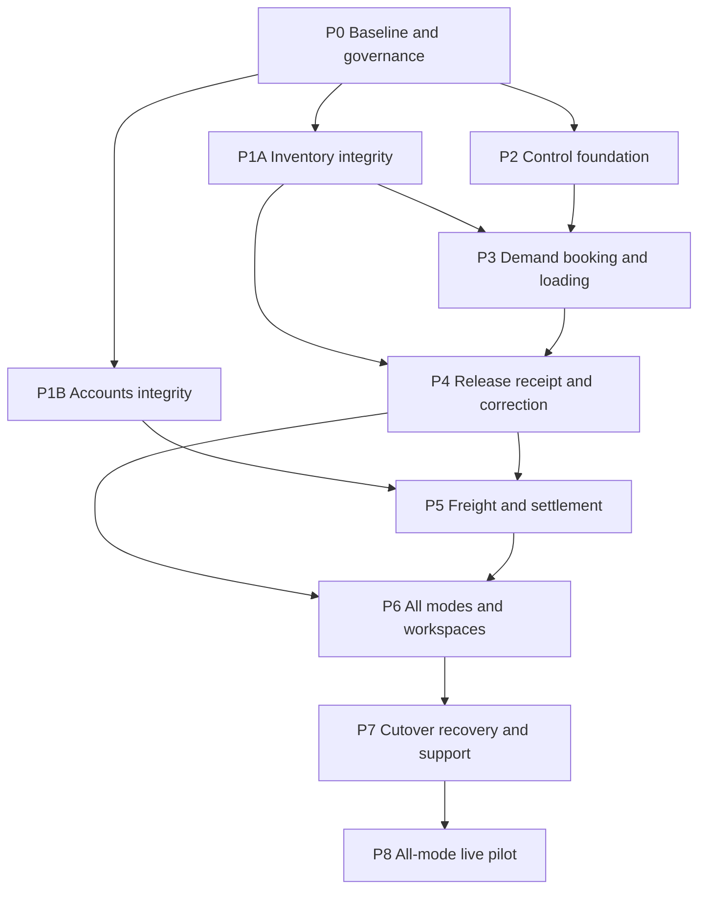

# Logistics Implementation Roadmap

## Execution rules

The phases below are the authoritative implementation and approval sequence. Units U1-U20 are bounded implementation slices governed by their complete parent-phase contract. A phase cannot exit on documentation or mocked-model results alone. Work may overlap only where dependencies and decision gates permit it.

## Unit registry

| Unit | Outcome | Phase |
| --- | --- | --- |
| U1 | Isolated current baseline and evidence protocol | P0 |
| U2 | Qualified Logistics foundation, suspension and removal lifecycle | P0 qualification; P2 implementation |
| U3 | Canonical quant creation and reservation integrity | P1A |
| U4 | Failure-atomic native transitions and enrolled execution guard | P1A |
| U5 | Bounded returns and issued-onsite correction | P1A |
| U6 | Immutable commercial quantity/packing commitments | P3 |
| U7 | Protected evidence lifecycle | P2 |
| U8 | Command identity, scoped approvals and suspension cutoff | P2 |
| U9 | Demand claims and native backorder/successor mapping | P3 |
| U10 | Trip, booking and actual loading workflow | P3 |
| U11 | Release batch, native issue and gate authority | P4 |
| U12 | Observation and receiving reconciliation | P4 |
| U13 | Cargo custody, returns, loss and correction | P4 |
| U14 | Reconciliation fixture and regression repair | P0 diagnosis; P1B implementation |
| U15 | Accounts advance/payment execution safeguards | P1B |
| U16 | Freight agreement and native financial allocations | P5 |
| U17 | Operator workspaces, documents and reports | P6 |
| U18 | Dedicated, multi-stop, carrier and pickup completion | P6 |
| U19 | Opening adoption, outage, restore and operational recovery | P7 |
| U20 | All-mode pilot qualification and activation | P8 |

## Unit execution index

Files marked new are proposed paths; implementation must follow current sibling conventions and use native generators where required.

| Unit | Primary implementation paths | Primary test paths | Depends on / gates |
| --- | --- | --- | --- |
| U1 | `scripts/run_logistics_phase2a_tests.sh`, `config/testing.php`, `phpunit.xml`, `plugins/webkul/support/tests/Helpers/TestBootstrapHelper.php` | `plugins/webkul/support/tests/Feature/Workflows/TestBootstrapPluginPathTest.php` | None |
| U2 | `plugins/shafique/logistics/src/Services/OperationalControl.php`, `plugins/shafique/logistics/src/Listeners/PreventRemoval.php`, plugin providers | `plugins/shafique/logistics/tests/Feature/FoundationTest.php`, `plugins/shafique/logistics/tests/Feature/RemovalTest.php` | U1 |
| U3 | `plugins/webkul/inventories/src/Models/ProductQuantity.php`, `plugins/webkul/inventories/src/Services/MoveReserver.php`, owner migration | `plugins/webkul/inventories/tests/Feature/Workflows/ReservationConcurrencyTest.php`, `plugins/webkul/inventories/tests/Feature/Workflows/QuantIdentityTest.php` (new) | U1, Q3 |
| U4 | `plugins/webkul/inventories/src/Services/TransferWorkflow.php`, move services, `plugins/webkul/inventories/src/InventoryManager.php`, native callers/hooks | `plugins/webkul/inventories/tests/Feature/Workflows/TransferIntegrityTest.php`, `plugins/webkul/inventories/tests/Feature/Workflows/TransferCompletionConcurrencyTest.php` (new), caller regressions | U3, Q3 |
| U5 | Inventory return request/controller and correction service (new if needed) | `plugins/webkul/inventories/tests/Feature/API/V1/DeliveryTest.php`, `plugins/webkul/inventories/tests/Feature/Workflows/ReturnConcurrencyTest.php`, `plugins/webkul/inventories/tests/Feature/Workflows/OnsiteIssueCorrectionTest.php` (new) | U4, Q3/Q4 |
| U6 | `plugins/webkul/sales/src/Services/OrderWorkflow.php`, `plugins/webkul/sales/src/Services/ProcurementRequester.php`, Sales snapshot model/migration | `plugins/webkul/sales/tests/Feature/Workflows/QuantityCommitmentTest.php`, `plugins/shafique/logistics/tests/Feature/PackingSnapshotTest.php` (new) | U1, Q1 |
| U7 | `plugins/shafique/logistics/src/Models/Evidence.php`, `plugins/shafique/logistics/src/Services/EvidenceStore.php`, migration/storage config (new) | `plugins/shafique/logistics/tests/Feature/EvidenceRetentionTest.php` (new) | U2, Q7 |
| U8 | `plugins/shafique/logistics/src/Services/OperationalControl.php`, command/approval services/models/policies/migrations (new) | `plugins/shafique/logistics/tests/Feature/CommandAuthorizationTest.php`, `plugins/shafique/logistics/tests/Feature/SuspensionConcurrencyTest.php` (new) | U2/U7, Q2/Q9 |
| U9 | Demand allocation model/service/migration and Inventory enrollment listener (new) | `plugins/shafique/logistics/tests/Feature/AllocationConcurrencyTest.php`, `plugins/shafique/logistics/tests/Feature/NativeLineageTest.php` (new) | U4/U6/U8, Q3 |
| U10 | Outbound shipment portion, trip, stop, booking and load models; shipment/allocation service; `plugins/shafique/logistics/src/Services/BookingWorkflow.php`; Filament workspace (new) | `plugins/shafique/logistics/tests/Feature/ShipmentPortionTest.php`, `plugins/shafique/logistics/tests/Feature/BookingWorkflowTest.php`, `plugins/shafique/logistics/tests/Feature/LoadingTest.php` (new) | U9, Q4/Q6; Q5 before freight-bearing fields or commands activate |
| U11 | `plugins/shafique/logistics/src/Services/ReleaseWorkflow.php`, release models/migration/gate actions (new) | `plugins/shafique/logistics/tests/Feature/ReleaseIntegrityTest.php`, `plugins/shafique/logistics/tests/Feature/GateAuthorizationConcurrencyTest.php` (new) | U5/U10 |
| U12 | Observation/receiving/allocation models and `plugins/shafique/logistics/src/Services/ReceiptReconciler.php` (new) | `plugins/shafique/logistics/tests/Feature/ReceiptReconciliationTest.php`, `plugins/shafique/logistics/tests/Feature/ReceiptConcurrencyTest.php` (new) | U7/U8/U11, Q2/Q6/Q10 |
| U13 | `plugins/shafique/logistics/src/Services/CargoWorkflow.php`, `plugins/shafique/logistics/src/Services/CorrectionWorkflow.php`, cargo/outcome/case models (new) | `plugins/shafique/logistics/tests/Feature/CargoConservationTest.php`, `plugins/shafique/logistics/tests/Feature/CorrectionDependenciesTest.php` (new) | U5/U12, Q4/Q10 |
| U14 | Existing Recon fixtures/support under `tests/Feature/Recon` | `tests/Feature/Recon/MatchAccountingIntegrationTest.php`, `tests/Feature/Recon/AutoMatchAtomicityTest.php`, `tests/Feature/Recon/MatchConcurrencyTest.php` | U1 |
| U15 | `plugins/webkul/accounts/src/Services/PaymentRegistrar.php`, `plugins/webkul/accounts/src/Services/Reconciler.php`, `plugins/webkul/accounts/src/Services/MoveWorkflow.php`, owner instruction/result schema | `plugins/webkul/accounts/tests/Feature/Workflows/PaymentConcurrencyTest.php`, `plugins/webkul/accounts/tests/Feature/Workflows/SupplierAdvanceTest.php`, `plugins/webkul/accounts/tests/Feature/Workflows/PaymentRecipientTest.php` (new) | U14, Q5 |
| U16 | `plugins/shafique/logistics/src/Services/FreightWorkflow.php`, charge/allocation models/migrations/actions (new) | `plugins/shafique/logistics/tests/Feature/FreightSettlementTest.php`, `plugins/shafique/logistics/tests/Feature/FreightAllocationTest.php` (new) | U12/U13/U15, Q2/Q5/Q6 |
| U17 | Logistics Filament resources/pages, `plugins/shafique/logistics/src/Queries/OperationalQueue.php`, views/language files (new) | `plugins/shafique/logistics/tests/Feature/OperationalWorkspaceTest.php`, `plugins/shafique/logistics/tests/Feature/DocumentAccessTest.php` (new) | U12/U13/U16, Q8/Q9 |
| U18 | Trip/stop/release extensions, `plugins/shafique/logistics/src/Services/ConsignmentWorkflow.php`, carrier/pickup associations (new) | `plugins/shafique/logistics/tests/Feature/MultiStopReleaseTest.php`, `plugins/shafique/logistics/tests/Feature/CarrierConsignmentTest.php`, `plugins/shafique/logistics/tests/Feature/DistributorPickupTest.php` (new) | U11-U13/U16, Q6 |
| U19 | `plugins/shafique/logistics/src/Services/OpeningAdoption.php`, `plugins/shafique/logistics/src/Services/RecoveryCoordinator.php`, recovery queues/runbook (new) | `plugins/shafique/logistics/tests/Feature/OpeningAdoptionTest.php`, `plugins/shafique/logistics/tests/Feature/RecoveryReplayTest.php` (new) | U17/U18, Q7/Q9/Q10 |
| U20 | Pilot evidence documents and accepted configuration | `plugins/shafique/logistics/tests/Feature/OutboundControlLoopTest.php`, all-mode browser/operational evidence | U19, Q1-Q10/Q13 applicable |

U2 and U14 have one discovery step and one implementation step. P0 may inspect, reproduce and record the current behavior, but it cannot mark either unit complete. U2 exits only in P2 after control, evidence and lifecycle behavior pass that phase's gates. U14 exits only in P1B after corrected fixtures and any reproduced accounting defect are resolved. Later phases depend on the implementation exit, not the P0 diagnosis.

## P0. Baseline, authority, and evidence environment

- **Objective:** Establish reproducible current truth, ownership, test isolation and decision governance before behavior changes.
- **Scope:** U1, U2 qualification, U14 diagnosis; current source/diff identity; caller/lock map; representative real documents and transaction samples; Q owners; no-write all-mode walkthroughs with coordinator, warehouse, gate, receiver, Accounts and backup roles.
- **Affected modules:** test bootstrap/configuration, `plugins/shafique/logistics`, Plugin Manager removal paths, existing Recon tests/support, repository logistics docs.
- **Dependencies:** None. Q1-Q10 receive owners and evidence plans; decisions need not all be closed to begin read-only work.
- **Database changes:** None outside disposable fixtures.
- **Commands/APIs/contracts:** Inventory/Sales/Accounts entry-point inventory; evidence execution record format; no production command changes.
- **Business rules:** Reported behavior is not reproduced behavior. Existing code does not approve business policy.
- **Validations:** Destructive bootstrap requires positive test-environment identity; external communications are disabled or intercepted.
- **Permissions:** Verify exact-company control and removal authority, including parent/child negatives.
- **Integration points:** Test runner, PostgreSQL and supported MySQL disposable targets, storage and notification fakes.
- **Tests:** Run automated isolation, cleanup-boundary, foundation, control, removal and current reconciliation-fixture tests. Separately perform read-only source and caller inspection plus facilitated paper and basic-phone walkthroughs for every transport mode and representative exception. Walkthrough results are operational evidence, not application-test results.
- **Acceptance:** Exact commands/results, engine/version, revision plus local-diff identity, caller map, lock map, decision owner/evidence register, and explained baseline failures; business owners approve vocabulary, responsibilities, documents and exception handoffs before related schemas freeze.
- **Migration/refactoring:** None. Convert reproduced defects into bounded P1 tasks; do not weaken assertions.
- **Out of scope:** Production posting, production database queries, schema migration, operational UI.

## P1A. Native Inventory integrity

- **Objective:** Make stock identity, reservation, completion/cancellation, returns and onsite correction correct for all callers.
- **Scope:** U3-U5.
- **Affected modules:** `plugins/webkul/inventories/src/Models/ProductQuantity.php`, `plugins/webkul/inventories/src/Services/MoveReserver.php`, `plugins/webkul/inventories/src/Services/TransferWorkflow.php`, move completion/cancellation/backorder services, `plugins/webkul/inventories/src/InventoryManager.php`, API/Filament/Barcode/Manufacturing callers.
- **Dependencies:** P0. U3 and U4 require the technical portions of Q3. U5 requires the approved return and onsite-correction rules in Q3 and Q4.
- **Database changes:** Additive quant identity/uniqueness and owner command/correction records only after duplicate/null preflight.
- **Commands/APIs/contracts:** IC3-IC5; owner services provide transaction participation, replay lookup and narrow enrolled precondition hook without importing Logistics.
- **Business rules:** Deterministic affected-root locking, no hidden partial completion, native backorders preserved, cumulative return bounded, issued-onsite correction distinct from customer return.
- **Validations:** Exact company/source membership, finite positive quantity, approved identity dimensions, state/revision, return availability, quality/lot.
- **Permissions:** Existing native authority plus service-level exact-company checks; correction requires scoped authority.
- **Integration points:** Logistics enrollment listener later in U9/U11; ordinary unenrolled callers remain compatible.
- **Tests:** Missing-quant race; 60+60 vs 100; complete-vs-cancel; two-operation rollback; subset/backorder; omitted/invalid return maps; cumulative returns; outer rollback; PostgreSQL/MySQL independent workers.
- **Acceptance:** Every relevant native writer invokes the transactional precondition hook and rejects a denying test guard; commands produce one coherent terminal/native result, onsite restoration is proven, and unenrolled behavior does not regress. U9/P3 proves the real enrollment listener for claimed cargo; U11/P4 proves frozen-release protection through the same callers.
- **Migration/refactoring:** Preflight then forward constraint; never auto-merge historical stock rows; refactor direct writers to owner services.
- **Out of scope:** Trips, receiving, freight, ERP-wide decimal rewrite.

## P1B. Native Accounts integrity

- **Objective:** Prove and protect real advances, payments, recipients, residuals, reversals and unknown outcomes.
- **Scope:** U14-U15.
- **Affected modules:** `plugins/webkul/accounts/src/Services/PaymentRegistrar.php`, `plugins/webkul/accounts/src/Services/Reconciler.php`, `plugins/webkul/accounts/src/Services/MoveWorkflow.php`, payment/register models, request/API/UI callers, Recon test support.
- **Dependencies:** P0; Q5.
- **Database changes:** Owner-local operation identity, instruction/result uncertainty and recipient authorization fields if existing records cannot express them.
- **Commands/APIs/contracts:** IC8 create/lookup/reconcile/reverse contract with stable business identity and changed-payload conflict.
- **Business rules:** Logistics approval is not posting; genuine advance may precede bill; supplier, recipient and payer remain distinct; holds/claims do not erase liability.
- **Validations:** Company, currency, journal, method, bank destination, recipient authority, amount and residual under lock.
- **Permissions:** Separate approve obligation, change recipient, instruct payment, confirm/reconcile and reverse authorities.
- **Integration points:** Manual/external payout remains pending until reconciled; no bank API assumed.
- **Tests:** Correct Recon fixtures; pre-bill apply-once; 60+60 payment race; lost response; late failure; separate supplier/recipient; distributor-paid freight; reversal; both engines.
- **Acceptance:** Native entries, reconciliation, residual, recipient and reversal explain every effect without duplicate authority.
- **Migration/refactoring:** Fix fixtures before production behavior; additive owner migration and existing-record linkage.
- **Out of scope:** New general ledger, fake final bill, generic payment provider integration.

## P2. Logistics control foundation

- **Objective:** Establish exact-company policies, protected evidence, command replay, scoped approvals, suspension and lifecycle safety.
- **Scope:** U2, U7, U8.
- **Affected modules:** Logistics service provider/plugin, `plugins/shafique/logistics/src/Services/OperationalControl.php`, removal listener, new evidence/command/approval services, policies and storage configuration.
- **Dependencies:** P0; Q2/Q7 and Q9 suspension decision.
- **Database changes:** DM6, DM7, DM13 and final DM14 fields.
- **Commands/APIs/contracts:** Internal application commands first; all UI/API actions later call the same services.
- **Business rules:** Same key/same intent returns canonical result; material revision invalidates scoped authority; incident capture survives suspension; old trip alone is not continuing authority.
- **Validations:** Company/revision/fingerprint, idempotency key format/root binding, content-detected evidence type/size/hash, cutoff eligibility, retention class.
- **Permissions:** Command/evidence-class least privilege, replay reauthorization, cross-company negative enforcement, separate administrator and read-only auditor duties.
- **Integration points:** Chatter references only; optional notifications after commit; Plugin Manager protections preserved.
- **Tests:** Suspension race; stale or revoked approval; replay after access revocation; idempotency collision, enumeration and preemption; active, mislabeled and traversal upload attempts; upload and SQL association failure; audit-history update and deletion denial; retained missing bytes; approved retention disposal and tombstone; legal hold; cross-company retrieval; uninstall and dependency removal.
- **Acceptance:** No new activity crosses the cutoff; no accepted record references missing or unsafe evidence; no replay bypasses current access; effective control/audit records cannot be overwritten or deleted through application paths.
- **Migration/refactoring:** Additive schema; reconcile existing controls rather than duplicating them.
- **Out of scope:** Generic workflow/event store, public evidence URLs, operational posting.

## P3. Commercial quantity, demand, booking, and loading

- **Objective:** Preserve historical quantity meaning and produce a verified executable load without shadow inventory.
- **Scope:** U6, U9, U10.
- **Affected modules:** Sales confirmation and line revision; Logistics allocation, outbound shipment portion, trip, stop, booking and load services; Filament engineering workspace; native UoM and Product packaging references.
- **Dependencies:** P1A, P2; Q1/Q2/Q4/Q6. Before P3 starts, Q13 must record whether regulated controls apply to each pilot product cohort. Applicable controls are blocking. Q5 is required before any freight-bearing booking field or command is activated; nonfinancial planning/loading may proceed while those controls remain inactive.
- **Database changes:** Sales commitment snapshots; Logistics DM1-DM4 and DM15.
- **Commands/APIs/contracts:** Allocate or release a planning claim, create or revise an outbound shipment portion, revise or cancel a booking, record actual assignment and load, and verify the load.
- **Business rules:** Master changes never rewrite history; actual values differ explicitly from planned values; missing values remain unknown and cannot be treated as zero; pricing is manually approved; source and backorder lineage is retained.
- **Validations:** Eligible source revision, exact conversion/rounding, product/lot/quality, segment capacity, provider/endpoint/role compatibility.
- **Permissions:** Planner, loader, verifier and configured freight approver separation.
- **Integration points:** IC1, IC2, IC6, IC7; source change invalidates or remaps claims.
- **Tests:** 6x12 snapshot survives 6x18 master change; nested pack counted once; competing claims; source reduction; partial load/backorder; replacement vehicle; basic-phone booking.
- **Acceptance:** A non-live one-operation journey reaches verified load with explainable native remainder and no unsupported inference.
- **Migration/refactoring:** Legacy provenance stays unknown; no current-master historical backfill.
- **Out of scope:** Live stock issue/departure, automatic rates/routes, arbitrary mixed-pack editor.

## P4. Release, receiving, custody, and correction

- **Objective:** Connect verified load to atomic native issue, controlled departure, truthful receipt, cargo conservation and bounded correction.
- **Scope:** U11-U13.
- **Affected modules:** Logistics release, gate, receipt, cargo and correction services/models/actions; Inventory IC3-IC5 seams.
- **Dependencies:** P3 and P1A; Q2/Q3/Q4/Q6/Q10 and applicable Q13.
- **Database changes:** DM5, DM8-DM11.
- **Commands/APIs/contracts:** Release, revoke, gate consume, depart/incident, record observation, verify/allocate receipt, transfer custody, return/loss/recover/correct.
- **Business rules:** Exact operation set commits once; report is not receipt; cumulative scope may cover multiple events; active leaves conserve quantity; correction preserves dependencies.
- **Validations:** Current approval/hold/load/native state, remaining quantity, event/attestation scope, collector/source attribution, correction bound.
- **Permissions:** Release approver, stock executor, gate, testimony recorder, verifier, correction and quality/disposition roles remain scoped.
- **Integration points:** Inventory-owned transaction and correction contracts; writes to an external goods-receipt system remain disabled under Q12.
- **Tests:** Operation-two rollback, response loss, revocation race, onsite abort, duplicate reports versus equal real receipts, ambiguous combined-order total, wrong distributor and loss recovery. If a correction has a financial dependency, P4 proves that the dependency remains open; P5/P7 proves the actual reversal or reallocation after freight linkage exists.
- **Acceptance:** Every dispatched unit has one effective outcome or owned outstanding state; no receipt reissues stock or invents source attribution.
- **Migration/refactoring:** Link existing native results without replay; adopt historical ambiguity explicitly.
- **Out of scope:** Automated claims or deductions, inferred fulfillment, and writes to an external goods-receipt system.

## P5. Freight and settlement

- **Objective:** Explain freight agreements and link every financial effect to authoritative Accounts records.
- **Scope:** U16 with P1B contracts.
- **Affected modules:** Logistics freight service/models/actions and native Accounts services.
- **Dependencies:** P1B and P4; Q2/Q5/Q6. Q13 must already record applicability for the affected product cohort, and any applicable controls remain blocking.
- **Database changes:** DM12 only; no copied ledger/residual.
- **Commands/APIs/contracts:** Approve agreement/extra, create authorized instruction through Accounts, link bill/advance/payment, hold/release, allocate/reverse.
- **Business rules:** Instruction/pending/posting/allocation distinct; exact total conservation; multi-trip bills and multi-payment trips; cancellation retains recoverable advance.
- **Validations:** Approved basis, supplier/recipient/payer/cost bearer, company/currency, rounding, nonoverlapping offsets/holds.
- **Permissions:** Operations agrees service; Accounts approves and executes financial effects; sensitive recipient changes require independent control.
- **Integration points:** IC8; distributor-paid case links native result without becoming product payment.
- **Tests:** Fixed charge plus extra, advance then bill, separate recipient, distributor payer, aggregate bill, partial hold, timeout race, cancellation, refund, reallocation, and paid or credited cargo correction from P4.
- **Acceptance:** Reviewer traces agreement to liability, instruction, payment, allocation, residual and reversal independently.
- **Migration/refactoring:** Link existing native records; never repost or synthesize balances.
- **Out of scope:** Automatic rate engine, bank integration, automatic shortage deduction.

## P6. All transport modes and operator experience

- **Objective:** Complete all mandatory modes through shared controls and usable role workspaces/documents.
- **Scope:** U17-U18.
- **Affected modules:** trip/stop/release/consignment/pickup services, Logistics Filament pages/resources, query services, views and language files.
- **Dependencies:** P4/P5; Q6/Q8, applicable Q9 targets and applicable Q13.
- **Database changes:** Only mode/endpoints/segment/handover associations not already present; no per-mode ledgers.
- **Commands/APIs/contracts:** Mode-specific handover, terminal and collector actions reuse shared command contracts.
- **Business rules:** A carrier terminal milestone is not customer receipt; a feeder movement does not issue stock twice; the carrier consignment reference, including the bilty number where that document is used, is issuer-scoped; pickup authority and freight responsibility are explicit.
- **Validations:** Required endpoints, roles, equipment, documents, responsibility and mode-specific recovery data.
- **Permissions:** Dispatcher, warehouse, gate, coordinator, verifier, Accounts, administrator and support workspaces expose only authorized tasks/data.
- **Integration points:** Native services plus internal assisted phone workflow; no portal dependency.
- **Tests:** Normal and failure/recovery journey for dedicated, multi-stop, carrier and pickup; provider replacement; collector mismatch; document/reprint; cross-company export; keyboard/call-only role play; paper-fallback exercise.
- **Acceptance:** Every mode completes loading, release, custody, receipt, freight where applicable, correction and recovery; every named primary and backup completes role training and competency signoff and accepts workload.
- **Migration/refactoring:** M5B adds only the approved endpoint, segment, collector, consignment and handover associations through the reviewed both-engine activation checkpoint; document templates are versioned with their governing decisions.
- **Out of scope:** Driver app, GPS, route optimization, full carrier network simulation.

## P7. Cutover, outage, restore, observability, and support

- **Objective:** Adopt in-flight work once, survive outage/restore, reconcile unknown effects and operate owned queues/runbooks.
- **Scope:** U19.
- **Affected modules:** Logistics opening adoption/recovery, queues/queries, bounded outbox only where required, operational docs/runbooks.
- **Dependencies:** P6; Q7/Q9/Q10 and applicable Q13.
- **Database changes:** Import batch/mapping, provisional reference and reconciliation records; durable outgoing work only for actual external effects.
- **Commands/APIs/contracts:** Dry-run opening import, staging rehearsal of apply, reconcile unknown outcomes, pause or resume scoped executors, and paper catch-up. The production apply command is implemented and tested here but cannot run against the live cohort until P8 cutover authorization.
- **Business rules:** Occurrence vs recording time; absent restored row does not prove remote failure; code rollback cannot undo goods/money; inactive user cannot orphan a team queue.
- **Validations:** Stable source identity, mapping uniqueness, evidence health, worker generation/fence and authoritative outcome lookup.
- **Permissions:** Import, recovery and support authorities are separate and audited.
- **Integration points:** Database plus protected-object restore; optional external lookup before replay.
- **Tests:** Reimport, paper departure plus unknown issue, old backup after payout, retained missing bytes and approved-disposal tombstones, stale worker, inactive assignee, and forward correction.
- **Acceptance:** Timed restore/outage/opening rehearsal meets approved targets with no unexplained effect or unsafe worker.
- **Migration/refactoring:** Build and rerun a dry-run opening map from an authorized read-only cohort extract; preserve legacy unknowns and native IDs. Do not apply the production opening batch in P7.
- **Out of scope:** Production opening adoption, invented historical events, destructive rollback, unapproved external adapter.

## P8. All-mode live pilot

- **Objective:** Activate a supervised limited cohort containing every mandatory transport mode and prove the complete control loop in operation.
- **Scope:** U20; one approved company/site cohort may be narrow, but dedicated, multi-stop, carrier and pickup all participate.
- **Affected modules:** No planned design change; all P0-P7 surfaces and support processes.
- **Dependencies:** P0-P7 accepted; Q1-Q10 and applicable Q13 approved; no unresolved critical defect.
- **Database changes:** Apply the approved final opening batch once after the cutover cutoff, late-change delta and reconciliation are accepted; defects use normal change control.
- **Commands/APIs/contracts:** Only previously accepted contracts.
- **Business rules:** Daily reconciliation; expansion freezes when integrity, workload or recovery thresholds fail.
- **Validations:** Every activation-matrix cell has owner/backup, normal, failure, recovery, stock, receipt, freight/no-charge and evidence proof.
- **Permissions:** Named primary and backup for every queue and emergency/recovery action.
- **Integration points:** Only adapters separately accepted under Q12; internal/manual fallback remains available.
- **Tests:** V1-V10 and AE1-AE30, plus observed live evidence under controlled cohort.
- **Acceptance:** Business owners approve reconciled results, service outcomes by mode, workload and recovery; all no-go conditions are absent; named hypercare coverage and escalation ownership remain active for the approved pilot period.
- **Migration/refactoring:** Fence affected cohort commands, record the cutoff and source high-watermarks, re-extract changes since rehearsal, apply the durable final batch once, prove a zero-effect rerun, reconcile fallback activity and publish the final cutover record.
- **Out of scope:** Other companies/sites, scale expansion, automatic rates/routes/docks, portals and speculative automation.

## Post-pilot work

Add automation only from measured bottlenecks and approved Q11/Q12 decisions. Each new site, company, provider category, product constraint or external adapter receives a change-impact review and reruns applicable gates.
