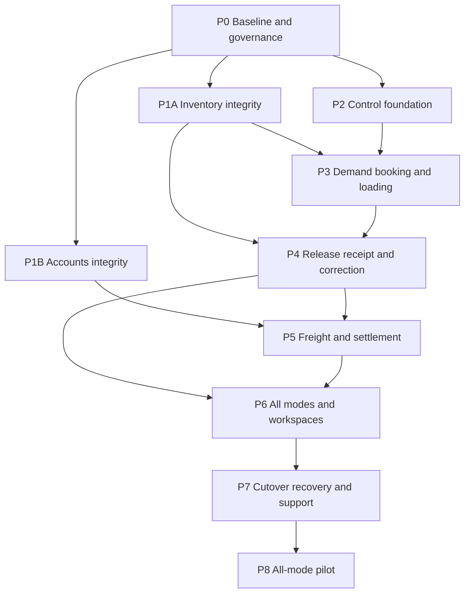

# Consolidated Logistics Plan Pack

This directory is the canonical target plan for the Shafique Foods outbound Logistics extension. It consolidates, reconciles, and strengthens the two supplied v0.2 plan packs. It is a target-state specification: existing AureusERP behavior is evidence about the starting point, not authority for the required business behavior.

## Authority hierarchy

When sources conflict, resolve them in this order:

1. Actual business requirements and observed operational reality.
2. Approved domain and architecture decisions recorded in this pack.
3. This consolidated plan pack.
4. Approved integration contracts and implementation specifications.
5. Existing AureusERP code and database structures.

Recommendations and examples from either source pack are not company policy unless adopted here or recorded as an approved decision. Existing code is reused only where it preserves the required invariants. A conflict with the target behavior creates refactoring work; it does not weaken the target behavior.

Current manual practice is evidence of business needs, constraints and exceptions; it is not automatically a requirement to preserve the same workflow. Evaluate spreadsheet steps and workarounds critically. The target may simplify, automate or replace them while preserving validated business outcomes and necessary controls. The same principle applies to existing AureusERP behavior.

PostgreSQL is the project database baseline under [ADR 0007](../../adr/0007-postgresql-project-baseline.md). Use it for migration, transaction, concurrency and release acceptance; other-engine compatibility is not an implicit requirement.

## Terms used throughout the plan

- **Exact Company:** The legal or operating Company record that owns the source transaction and resulting stock, financial, transport, and evidence records. A child Company used as a branch is still a distinct Company for authorization and data isolation.
- **Authoritative owner:** The module responsible for validating and changing a business record. For example, Inventory is the authoritative owner of stock balances, so Logistics must request stock changes through Inventory operations instead of updating stock tables directly.
- **Approval authority:** A recorded permission to perform one defined action within an approved scope, revision, amount, and validity period. It is not a job title or a general override.
- **Commercial commitment:** The approved customer-facing product, quantity, unit, and packaging meaning that must remain explainable after master data changes.
- **Planning claim:** The quantity-consuming state of a Logistics demand allocation. It does not reserve stock and is unrelated to a cargo damage claim or a financial compensation claim.
- **Release batch:** The exact verified load and native Inventory operations approved for one factory departure.
- **Gate authority:** Single-use permission for the current verified departure revision after the required Inventory issue succeeds.
- **Cargo cohort and cargo portion:** A cohort is product, unit, packing and lot quantity created from one known outbound stock issue. A portion is a current nonoverlapping part of that cohort with one known or explicitly uncertain custody position.
- **Receipt observation and cumulative receipt confirmation:** An observation records what one source reports. A cumulative receipt confirmation records a supported total through a defined cutoff; technical records call it a cumulative attestation.
- **Canonical result:** The one saved result of a consequential command, returned again only when a replay has the same significant intent and current access remains valid.
- **Service endpoint:** The contractual point where a transport provider's agreed responsibility ends. It does not automatically mean that the customer or distributor received the goods.
- **Carrier consignment reference:** The provider-issued document or reference for a carrier consignment. Where the business uses a bilty, its bilty number is this reference; the term does not imply customer receipt or an internal carrier route.
- **Significant intent:** The quantity, parties, destination, recipient, vehicle, load, payment or other fields whose change requires a new command identity or approval.
- **Shadow ledger:** A Logistics balance that competes with the official stock balance in Inventory or the official financial balance in Accounts.
- **Allocation:** A planning record that assigns part of eligible demand, cargo, a receipt, or a financial amount to a defined purpose. An allocation does not itself move stock or money.
- **Reservation:** Inventory's temporary assignment of available stock to a native stock movement. A Logistics demand claim is separate and cannot substitute for an Inventory reservation.
- **Custody:** The party currently responsible for physical goods. Custody can change without changing stock ownership, customer acceptance, or accounting recognition.
- **Immutable snapshot:** A historical copy of the business facts used for a decision or transaction. Later master-data changes do not alter the recorded snapshot; corrections create linked records.
- **Reconciliation:** Comparison of independent records to explain agreement, differences, duplicates, missing effects, and unresolved amounts or quantities. Reconciliation does not create facts merely to make totals match.
- **Operational closure:** The transport and goods-handling obligations are complete under the approved Q10 rule. Assigning an owner and next action does not close an exception; the work remains operationally open unless Q10 explicitly permits transfer to another authoritative process that accepts responsibility.
- **Financial closure:** Every freight liability, advance, bill, payment, allocation, hold, claim, reversal, and remaining balance is fully resolved in the Accounts module under the approved Q10 rule. An unresolved liability, hold, claim, payment uncertainty or balance remains financially open. Operational closure does not imply financial closure, and financial closure does not prove delivery.
- **Approved evidence disposal:** Destruction performed after the approved retention period and legal-hold checks. The system retains an immutable tombstone containing the evidence identity, hash, metadata, authorization, disposal time and result. Approved disposal is different from accidental loss or corruption.

Use qualified terms where the underlying action differs. “Claim” means planning claim, cargo-loss claim, or financial compensation claim. “Release” means Sales release, Inventory issue, gate authority, quality-hold release, or payment authorization. “Hold” means a commercial, Inventory, quality, or payment hold. Documents must not use the unqualified term when more than one meaning is possible.

## Goal and pilot boundary

Build one auditable outbound control loop from eligible demand through packing, transport booking, loading, native stock issue, physical departure, custody, receiving, exceptions, returns, freight accounting, and recovery.

The first live pilot includes all four required transport modes. Each mode still needs its approved responsibility matrix, applicable decisions, and acceptance evidence before the pilot can start:

- dedicated hired vehicles;
- multi-stop deliveries;
- goods-transporter consignments, including applicable feeder, terminal, and final-mile handovers;
- distributor-arranged pickup.

Implementation proceeds in small dependency-ordered increments, prioritizing dedicated vehicles and multi-stop delivery before carrier consignments and distributor pickup. The [roadmap priority](08-IMPLEMENTATION-ROADMAP.md#current-implementation-priority) changes engineering order, not the approved all-four-mode live pilot gate. Completion of one increment does not authorize a narrower live pilot.

## Document map

| Document | Purpose | Primary IDs |
| --- | --- | --- |
| [01-SCOPE-AND-REQUIREMENTS.md](01-SCOPE-AND-REQUIREMENTS.md) | Consolidated business scope, actors, requirements, exclusions, and success measures. | R1-R40 |
| [02-DOMAIN-MODEL.md](02-DOMAIN-MODEL.md) | Target aggregates, identities, invariants, quantities, money, and evidence semantics. | D1-D20 |
| [03-WORKFLOWS-AND-LIFECYCLES.md](03-WORKFLOWS-AND-LIFECYCLES.md) | Normal, partial, cancellation, correction, retry, and recovery flows. | F1-F14 |
| [04-TARGET-ARCHITECTURE.md](04-TARGET-ARCHITECTURE.md) | Target architecture, ownership, transaction boundaries, security, and operability. | KTD1-KTD14 |
| [05-INTEGRATION-CONTRACTS.md](05-INTEGRATION-CONTRACTS.md) | Required contracts with Sales, Inventory, Accounts, Products, Partners, Support, and optional external systems. | IC1-IC12 |
| [06-DATA-MODEL-AND-MIGRATION.md](06-DATA-MODEL-AND-MIGRATION.md) | Persistence families, constraints, migration, adoption, rollback, and historical data. | DM1-DM15 |
| [07-AUREUSERP-GAP-AND-REFACTOR-MAP.md](07-AUREUSERP-GAP-AND-REFACTOR-MAP.md) | Current implementation conflicts and the required changes. | G1-G18 |
| [08-IMPLEMENTATION-ROADMAP.md](08-IMPLEMENTATION-ROADMAP.md) | Dependency-ordered phases and implementation units. | P0-P8, including P1A/P1B; U1-U20 |
| [09-TESTING-AND-ACCEPTANCE.md](09-TESTING-AND-ACCEPTANCE.md) | Test strategy, concurrency proof, end-to-end scenarios, and acceptance gates. | V1-V10, AE1-AE30 |
| [10-ROLLOUT-OPERATIONS-AND-RISK.md](10-ROLLOUT-OPERATIONS-AND-RISK.md) | Cutover, all-mode pilot, recovery, observability, support, and risk controls. | L1-L10, RK1-RK20 |
| [11-SOURCE-TRACEABILITY.md](11-SOURCE-TRACEABILITY.md) | Source comparison, reconciliations, requirement coverage, and provenance. | Source requirement families and target mappings |
| [12-OPEN-DECISIONS.md](12-OPEN-DECISIONS.md) | Decisions requiring accountable owners and evidence. | Q1-Q13 |

## How implementation agents should use the pack

1. Read this file and the phase entry in `08-IMPLEMENTATION-ROADMAP.md`.
2. Use the unit execution index to locate the bounded code and test surface, then apply the complete contract of its parent phase and the linked R, D, F, KTD, IC, DM, G, V, AE, and Q documents.
3. Verify current source before editing. The gap map is a dated baseline, not permission to assume code is unchanged.
4. Implement the smallest owner-correct change that satisfies the cited contracts.
5. Run the phase's verification gates and record evidence before activating dependent work.
6. Stop when a blocking Q decision, unknown native outcome, unsafe quantity conversion, unproven correction, or accounting ambiguity is reached.

## Implementation order

The [stock-readiness target proposal](03-WORKFLOWS-AND-LIFECYCLES.md#stock-readiness-before-loading-proposed-target-for-review) extends F1 with explicit demand, available-stock, future-production and deadline rules. Review its five choices in Q1/Q2/Q3/Q4/Q6 before implementing affected behavior. The [four-mode tabletop review](../P0-TRANSPORT-MODE-TABLETOP-2026-09-24.md) records design scenarios and missing operational evidence; it is not operational signoff.

P0 and approved discovery work may start immediately. Dependent Logistics features may start only after their blocking decisions and predecessor acceptance criteria are satisfied. The owner has authorized bounded Inventory and Accounts integrity repairs to proceed while unrelated P0 operational evidence is collected, provided the specific task has an isolated baseline, a reproduced defect or failing test, and no unresolved business-policy dependency. This exception does not close P0 or waive PostgreSQL acceptance. The live pilot requires all P0-P7 gates; no mode is enabled merely to satisfy a schedule.

## Global stop conditions

- A quantity, UoM, packing factor, lot, or source identity is unknown or unsupported.
- The native stock, receipt, payment, or external command outcome is unknown.
- Required evidence is missing, inaccessible, or not durable.
- The actor, company, recipient, payer, or approval scope is ambiguous.
- A shared writer can bypass a claimed or frozen Logistics invariant.
- Issued-but-onsite stock cannot be corrected through an approved native path.
- A change would create a shadow inventory, receivable, payable, or cash ledger.
- A blocking decision in `12-OPEN-DECISIONS.md` has no approved owner/evidence.

## Pack completeness

The roadmap is implementation-ready at the phase level: each phase defines objective, bounded units, dependencies, affected areas, data/API implications, rules, permissions, tests, acceptance criteria, migration/refactoring work, and exclusions. The unit index supplies the intended implementation and test surface within that contract. Some work is intentionally decision-gated; the pack does not pretend unresolved business policy is an engineering default.

Validate the pack structure with `python3 docs/logistics/plan/tools/validate_pack.py`. If the original source directories are available, add `--source-a /path/to/shafique-foods-logistics-v0.2 --source-b /path/to/shafique-outbound-transport-v0.2.0` to verify the recorded source files as well.
