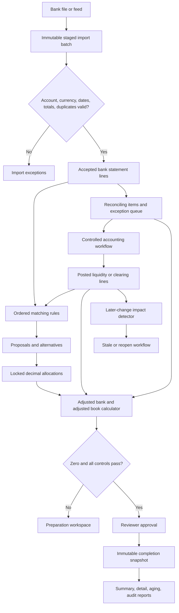
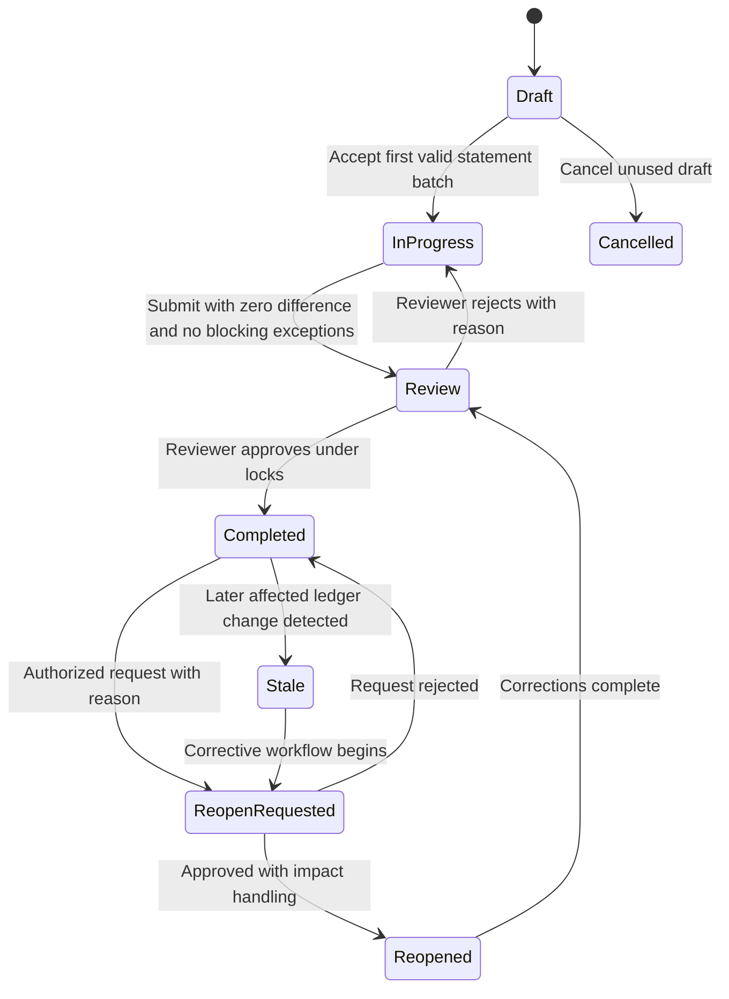
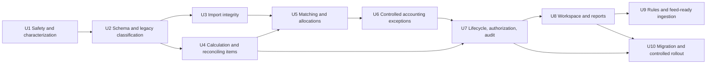

# Enterprise Bank Reconciliation - Plan

## Goal Capsule

- **Objective:** Replace the current reconciliation prototype with a production-safe bank reconciliation flow that produces correct accounting results, supports controlled month-end close, and reaches mature accounting-product usability in phases.
- **Authority order:** Accounting invariants and posted-ledger integrity override current prototype behavior. The approved phased scope overrides convenience and backward compatibility with unsafe match effects. Existing accounting workflows must be reused before new posting logic is introduced.
- **Execution profile:** Deliver P0 accounting safety first, P1 professional workflow second, and P2 feeds and advanced automation last. Use guarded forward migrations and characterization-first tests. Do not reset or rewrite existing data destructively.
- **Release boundary:** Keep confirm-match, adjustment-posting, completion, and reopening unavailable in production until their P0 units and release gates pass.
- **Stop conditions:** Stop migration or rollout if existing reconciliation rows cannot be classified safely, if a proposed change would silently rewrite posted ledger history, or if the isolated test database is not confirmed.
- **Tail ownership:** U10 owns legacy-data disposition, controlled enablement, operational checks, and rollback readiness.

---

## Product Contract

### Summary

Build a phased enterprise bank reconciliation capability. The first phase restores accounting correctness and data integrity. The second phase adds professional review, exception, reporting, and usability workflows. The third phase adds configurable automation and provider-neutral feed readiness without selecting a speculative bank-feed vendor.

### Problem Frame

The current flow imports statement rows, proposes matches, writes adjustments, marks accounting residuals, and completes reconciliations. Several of those operations use incorrect accounting boundaries or incomplete data. The current difference calculation does not represent outstanding checks or deposits in transit. Imported transaction dates are discarded. Matching can target arbitrary receivable and payable lines. Adjustment posting bypasses the accounting module's established posting workflow. Completion and reopening do not preserve a reliable period-close chain.

The module therefore cannot be treated as evidence that the bank statement and general ledger agreed at a historical date. A zero shown by the current screen is not sufficient proof of a valid reconciliation.

### Key Decisions

- **Phased enterprise delivery.** (session-settled: user-approved — chosen over full implementation at once and P0-only remediation: accounting safety must land before feeds and advanced automation.) Governs R1-R32.
- **Timing differences remain reconciling items.** Outstanding payments and deposits in transit do not create journal entries merely to force a zero difference. Governs R7-R9.
- **Bank reconciliation does not replace subledger reconciliation.** Bank statement activity clears liquidity or bank-clearing move lines; AR/AP settlement remains owned by the accounting module. Governs R13-R17.
- **Production enablement is gated.** Unsafe financial mutations remain unavailable until accounting, lifecycle, audit, and migration gates pass. Governs R27, R29-R32.

### Actors

- A1. **Preparer:** Imports the statement, reviews matches, classifies exceptions, and prepares adjustments.
- A2. **Reviewer:** Reviews evidence, rejects or approves the reconciliation, and cannot silently alter prepared accounting data.
- A3. **Controller or administrator:** Configures bank accounts, rules, tolerances, lock dates, permissions, and approved adjustment accounts.
- A4. **Bank data source:** Provides a file, feed batch, statement identity, account identity, currency, balances, and transactions.
- A5. **Auditor or read-only user:** Reproduces a completed reconciliation from immutable evidence without changing it.
- A6. **Accounting services:** Own journal posting, reversal, AR/AP reconciliation, currency treatment, and payment-status computation.

### Requirements

#### Account, period, and balance integrity

- R1. A reconciliation belongs to one company, one bank account, one liquidity or bank-clearing account, one journal, and one currency.
- R2. Cash-on-hand reconciliation uses a cash-count workflow and is not presented as a bank-statement import.
- R3. The statement start date, statement end date, statement date, transaction date, and value date are stored according to their distinct meanings.
- R4. The bank beginning balance defaults from the prior completed statement and cannot diverge without a documented first-time or discontinuity workflow.
- R5. The GL beginning and ending balances are independently derived from posted move lines at the applicable cutoff.
- R6. Reconciliation periods cannot overlap for the same bank account, and only one active reconciliation may exist per bank account unless an administrator resolves the conflict.
- R7. The adjusted bank balance equals statement ending balance plus deposits in transit minus outstanding payments plus or minus documented bank errors.
- R8. The adjusted book balance equals the GL cash balance before reconciliation-created adjustments plus the bank-account effects of those posted adjustments; the same move is never counted in both components.
- R9. Completion requires adjusted bank balance to equal adjusted book balance at currency precision and requires every difference to be classified.
- R10. Reconciliation status never changes the financial-statement cash balance; it supplies close-control status, exceptions, and audit evidence around posted GL data.

#### Statement acquisition and import integrity

- R11. Every accepted import preserves source identity, original file metadata, a content hash, parser version, account identity, currency, balances, control totals, and import actor in access-controlled storage governed by a retention policy.
- R12. Duplicate detection uses stable bank transaction identifiers where available and a deterministic fingerprint fallback; duplicate rows are quarantined or excluded rather than silently accepted as normal activity.
- R13. Import is idempotent, validates date and amount formats without binary floating-point conversion, and cannot silently replace an active statement.
- R14. The system supports mapped CSV first, then OFX/QFX and common structured statement formats according to customer demand.

#### Matching and allocation

- R15. Ledger candidates come only from posted, eligible move lines on the selected liquidity or configured bank-clearing account, including prior-period items still outstanding.
- R16. A bank match cannot directly manipulate arbitrary receivable or payable residuals.
- R17. AR/AP settlement, payment state, exchange differences, matching numbers, and reconciliation reversal remain owned by `Webkul\Account\Services\Reconciler` and related accounting workflows.
- R18. Automatic matching uses configurable ordered rules and hard eligibility gates for company, account, currency, sign, remaining amount, and duplicate consumption.
- R19. Automatic decisions record the rule, inputs, confidence, alternatives, and actor; ambiguous candidates remain proposals.
- R20. Manual matching supports 1:1, 1:N, N:1, N:M, partial allocation, batch deposits, merchant-net settlements, and explicit residual amounts.
- R21. Confirmed allocations are concurrency-safe, cannot exceed either side's remaining amount, and reverse exactly.

#### Exceptions and book-side accounting

- R22. Every unmatched item can be classified as timing, missing book entry, bank error, duplicate, returned payment, transfer, unidentified, disputed, or investigation required.
- R23. Bank errors and timing differences do not post to the GL unless a separate accounting event justifies a journal entry.
- R24. Bank fees, interest, direct debits, returned payments, transfers, FX differences, corrections, and suspense entries use transaction-specific accounting workflows with explicit accounts, dates, currencies, dimensions, evidence, and approvals.
- R25. Posted corrections use linked reversal or correcting entries; reconciled or posted history is not hard-deleted or silently rewritten.
- R26. Inter-account transfers link both bank-account sides through a transfer or clearing entry without creating profit or loss.

#### Lifecycle, authorization, audit, and reporting

- R27. The lifecycle is enforced server-side as Draft, In progress, Review, Completed, Reopen requested, Reopened, Stale, or Cancelled with only documented transitions.
- R28. Prepare, post adjustment, submit, review, complete, reopen, administer rules, and view audit evidence are separate permissions.
- R29. Completion revalidates all invariants under database locks, respects the accounting lock date, records preparer and reviewer, and can require different users by company policy.
- R30. Completion stores an immutable snapshot of statement identity, balances, matches, reconciling items, adjustments, approvals, source hashes, and report totals.
- R31. Any later edit, reversal, void, reset-to-draft, deletion, or backdated posting that affects a completed reconciliation blocks the action or marks the affected reconciliation and all dependent later reconciliations stale.
- R32. Reopening requires a reason, permission, impact preview, approval where configured, and ordered treatment of later reconciliations.

#### Professional product behavior

- R33. The workspace provides searchable, filterable, paginated bank and ledger panes with real dates, references, counterparties, amounts, currency, remaining allocation, match rationale, and source drill-down.
- R34. The exception queue provides classification, owner, age, notes, attachments, resolution status, and links to the originating accounting transaction.
- R35. The dashboard shows last reconciled date, current statement status, unresolved prior items, stale periods, feed/import health, preparer, reviewer, and overdue accounts.
- R36. Reports include reconciliation summary, reconciliation detail, outstanding-item aging, adjustment detail, exception detail, history, and immutable completed snapshots.
- R37. Rules can suggest or auto-confirm transactions only within controller-defined risk limits and must expose rule order, last use, and false-match review history.
- R38. P2 bank feeds use the same staged import contract as files and do not post or match directly from provider callbacks.

### Key Flows

- F1. **Create and establish continuity**
  - **Trigger:** A1 selects a bank account and statement period.
  - **Actors:** A1, A3, A6.
  - **Steps:** Validate configuration and active-session uniqueness; derive prior ending and GL opening balances; resolve first-time or discontinuity exceptions; create Draft.
  - **Outcome:** A valid reconciliation shell with known account, currency, dates, and continuity.
  - **Covered by:** R1-R6, R27-R29.
- F2. **Import and validate statement**
  - **Trigger:** A1 uploads or receives a statement batch.
  - **Actors:** A1, A4.
  - **Steps:** Stage source; identify format; parse decimals and dates; validate control totals and account identity; quarantine errors and duplicates; accept an idempotent batch.
  - **Outcome:** In-progress reconciliation with immutable source evidence and valid statement lines.
  - **Covered by:** R3, R11-R14, R27.
- F3. **Match and allocate**
  - **Trigger:** Valid bank and eligible liquidity lines are available.
  - **Actors:** A1, A6.
  - **Steps:** Apply ordered rules; present proposals and alternatives; allocate manually when required; confirm under locks; retain accurate residuals.
  - **Outcome:** Explainable, reversible matches without direct AR/AP corruption.
  - **Covered by:** R15-R21, R33, R37.
- F4. **Resolve exceptions and create book entries**
  - **Trigger:** An imported item has no valid book-side match.
  - **Actors:** A1, A2, A3, A6.
  - **Steps:** Classify the item; determine timing versus book-side action; create a controlled accounting transaction when justified; attach evidence; match the resulting liquidity line.
  - **Outcome:** The item is matched, carried forward, excluded, disputed, or assigned for investigation with a valid accounting reason.
  - **Covered by:** R22-R26, R34.
- F5. **Review and complete**
  - **Trigger:** The preparer submits a zero-difference reconciliation.
  - **Actors:** A1, A2, A5, A6.
  - **Steps:** Freeze preparation changes; revalidate balances and allocations; review evidence and outstanding items; approve under locks; create the immutable snapshot.
  - **Outcome:** Completed reconciliation and durable close evidence.
  - **Covered by:** R7-R10, R27-R30, R36.
- F6. **Handle later corrections**
  - **Trigger:** A user attempts to alter affected posted activity or requests a historical reopen.
  - **Actors:** A2, A3, A5, A6.
  - **Steps:** Detect impact; block or mark stale; preview later periods; approve reopen or use a current-period correcting entry; retain original and revised snapshots.
  - **Outcome:** Historical evidence remains explainable and dependent reconciliations cannot appear valid incorrectly.
  - **Covered by:** R25, R27-R32, R36.

### Acceptance Examples

- AE1. **Outstanding payment:** Given a posted bank-account credit dated before statement end that has not cleared the bank, when the reconciliation is calculated, then it appears as an outstanding payment and reduces adjusted bank balance without creating a new journal entry. Covers R5, R7-R10, R15.
- AE2. **Deposit in transit:** Given a posted bank-account debit before cutoff that appears on the next bank statement, when the current period completes, then it carries forward as a deposit in transit and later clears against the next statement. Covers R7, R15, R20-R21.
- AE3. **Bank fee:** Given a fee on the statement with no book entry, when A1 creates a fee transaction, then the normal accounting workflow posts the approved expense and bank credit before matching. Covers R17, R24-R25.
- AE4. **Bank error:** Given a bank debit that the bank confirms is erroneous, when A1 classifies it as a bank error, then no GL adjustment is created and the item remains tracked until corrected by the bank. Covers R22-R23, R34.
- AE5. **Returned customer payment:** Given a previously settled customer receipt is returned, when A1 resolves the exception, then the original settlement is reversed through accounting services, the receivable reopens, any fee is separate, and the bank transaction matches the resulting liquidity entry. Covers R16-R17, R22, R24-R25.
- AE6. **Duplicate import:** Given the same bank file or provider event is received twice, when the second batch is processed, then no second accepted transaction or GL effect is created. Covers R11-R13.
- AE7. **Ambiguous auto-match:** Given two eligible book lines have equal amount and similar references, when rules run, then the bank line remains a proposal with both alternatives instead of auto-confirming. Covers R18-R19, R37.
- AE8. **Split settlement:** Given one net bank deposit represents three receipts less a merchant fee, when A1 allocates the deposit, then each allocation and the fee remain visible, totals balance, and all residuals reverse exactly on unmatch. Covers R20-R21, R24.
- AE9. **Concurrent confirmation:** Given two users attempt to consume the same remaining ledger amount, when both confirm, then one succeeds and the other receives a stale-allocation error without partial accounting effects. Covers R21, R29.
- AE10. **Closed period:** Given the statement period is locked, when A1 tries to post a backdated fee, then posting is blocked and the reconciliation explains the lock. Covers R24, R29.
- AE11. **Completed transaction edit:** Given a move line belongs to a completed reconciliation, when a user reverses or resets its move, then the system blocks the action or marks that reconciliation and every later dependent reconciliation stale. Covers R25, R31.
- AE12. **Historical reopen:** Given March and April are completed, when March is approved for reopening, then April cannot remain valid silently and both original snapshots remain available. Covers R30-R32.
- AE13. **Multi-company isolation:** Given equivalent account codes in two companies, when A1 reconciles one company, then no statement, ledger candidate, rule, allocation, adjustment, report, or event from the other company is visible or mutable. Covers R1, R15, R18, R28.
- AE14. **Completed report reproducibility:** Given the live ledger changes after completion, when A5 opens the completed report, then the approved snapshot remains unchanged and a separate stale indicator explains any later impact. Covers R30-R31, R36.

### Success Criteria

- Every completion is supported by a mathematically correct adjusted-bank and adjusted-book proof.
- No reconciliation path changes AR/AP residuals outside the established accounting reconciler.
- Repeating an import or match command is idempotent and cannot double-consume a transaction.
- Every financial mutation is atomic with its audit record or fails without accounting effects.
- Completed reports are reproducible from stored snapshots.
- Historical changes cannot leave later reconciliations appearing valid silently.
- P0 verification passes on an isolated test database before production mutation actions are enabled.

### Scope Boundaries

#### Included

- Repair and harden the current `app/Models/Recon`, `app/Services/Recon`, and Filament reconciliation surfaces.
- Integrate with the accounts plugin's posting, reversal, payment, currency, and reconciliation services.
- Add the minimum shared accounting lock-date enforcement required to make reconciliation adjustments and historical protection safe.
- Add mapped CSV and a provider-neutral staged import contract.
- Plan standard file adapters, rules, dashboards, reports, and eventual feeds as phased units.

#### Deferred until P2 or a separate provider decision

- Selection, licensing, and implementation of a live bank-feed provider.
- Machine-learning match models; deterministic and explainable rules come first.
- Jurisdiction-specific statutory certification beyond the general accounting and internal-control requirements in this plan.

#### Outside this plan

- A complete treasury-management system, cash forecasting, payment initiation, fraud-monitoring platform, or bank-signatory workflow.
- A general rewrite of invoices, payments, or the entire accounting plugin beyond safeguards and integration points required by reconciliation.

### Dependencies

- The accounts plugin's `MoveWorkflow`, `MoveCalculator`, `Reconciler`, payment models, journal configuration, currencies, and move-line relationships must remain the owners of posted-accounting behavior.
- An isolated `aureuserp_testing` database must be available before running financial mutation tests.
- Existing reconciliation and partial-reconcile rows must be inventoried before any constraint or backfill migration runs.
- Product owners must choose a bank-feed provider and supported regions before the P2 live connector is implemented.

### Sources

- Current implementation: `app/Services/Recon/StatementImporter.php`, `app/Services/Recon/MatchingEngine.php`, `app/Services/Recon/MatchService.php`, `app/Services/Recon/AdjustmentService.php`, `app/Services/Recon/FinalizationService.php`.
- Current UI and reports: `app/Filament/Pages/Recon`, `resources/views/filament/pages/recon`.
- Current schema: `database/migrations/2026_09_07_000001_create_recon_tables.php`, `database/migrations/2026_09_07_000002_add_recon_match_id_to_partial_reconciles.php`, `database/migrations/2026_09_07_000003_add_reconciliation_page_permissions.php`.
- Existing accounting owners: `plugins/webkul/accounts/src/Services/Reconciler.php`, `plugins/webkul/accounts/src/Services/MoveWorkflow.php`, `plugins/webkul/accounts/src/Services/MoveCalculator.php`.
- Product references: [QuickBooks reconciliation](https://quickbooks.intuit.com/learn-support/en-us/help-article/statement-reconciliation/reconcile-account-quickbooks-online/L3XzsllsK_US_en_US), [Sage 50 reconciliation](https://help-sage50.na.sage.com/en-us/2024/Content/Banking_General_Ledger/Account_Reconciliation/Reconcile_an_account_bank_statement_reconciliation.htm), [Xero bank reconciliation](https://www.xero.com/us/accounting-software/reconcile-bank-transactions/), [Dynamics 365 advanced bank reconciliation](https://learn.microsoft.com/en-us/dynamics365/finance/cash-bank-management/advanced-bank-reconciliation-overview), [NetSuite matching](https://docs.oracle.com/en/cloud/saas/netsuite/ns-online-help/article_32131451402.html), [SAP bank statement reprocessing](https://help.sap.com/docs/SAP_S4HANA_CLOUD/147436affce24e81892eee2076a78116/287ed79dd2ad45dbbb58c464a2fea4f3.html).

---

## Planning Contract

### Key Technical Decisions

- KTD1. **Keep bank matching separate from AR/AP settlement.** Match statement lines to liquidity or configured bank-clearing move lines. Invoke `Reconciler` only through the payment or accounting workflow that owns the corresponding debit and credit lines. This implements R15-R17.
- KTD2. **Use a dual-sided reconciliation calculation.** Replace `bank opening + period GL movement` with independently derived adjusted-bank and adjusted-book totals whose components drill down to source records. This implements R4-R10.
- KTD3. **Represent timing differences and exceptions explicitly.** Add reconciling items with side, classification, source, amount, origin period, carry-forward state, owner, evidence, and resolution instead of inferring outstanding checks from open AR/AP. This implements R7-R9 and R22-R23.
- KTD4. **Preserve real bank dates and source identity.** Add transaction date, optional value date, external ID, import batch, source fingerprint, and transaction code to statement lines. This implements R3 and R11-R14.
- KTD5. **Store allocation amounts as the matching truth.** Confirmations consume decimal remaining amounts under row locks. They do not derive the applied amount from the full move-line balance. This implements R18-R21.
- KTD6. **Reuse accounting workflows for every journal mutation.** Build draft moves through existing models and calculators, post through `MoveWorkflow`, settle subledgers through `Reconciler`, and reverse through `MoveWorkflow::reverse`. Direct inserts into move and partial-reconcile tables are removed from reconciliation services. This implements R16-R17 and R24-R26.
- KTD7. **Enforce lifecycle and permissions below the UI.** Policies and domain services validate every transition and action. Filament visibility is only presentation. This implements R27-R29 and R32.
- KTD8. **Make audit evidence atomic and completed results immutable.** Domain mutations and event creation share one transaction. Completion writes a versioned snapshot and hash that reports read instead of recalculating approved history. This implements R19 and R29-R32.
- KTD9. **Use database constraints and pessimistic locks for financial invariants.** Foreign keys, checks, uniqueness where expressible, row locks, and post-lock revalidation protect company scope, active sessions, allocation totals, and completion. This implements R1, R6, R13, R21, and R29.
- KTD10. **Use guarded forward migration for existing prototype data.** Add nullable columns, inventory and classify rows, backfill only provable values, quarantine ambiguous sessions as legacy-unverified, then add constraints. Never reset reconciliation or ledger tables. This implements R11-R13 and R30-R32.
- KTD11. **Use one staged ingestion contract for files and feeds.** Providers write immutable staged batches; validation accepts them into statement lines. Provider callbacks cannot post journals, confirm matches, or complete reconciliations. This implements R11-R14 and R38.
- KTD12. **Ship deterministic rules before learned matching.** Ordered account-specific rules and explainable scores cover P1. Machine-learning suggestions remain outside scope until false-match metrics justify them. This implements R18-R19 and R37.

### High-Level Technical Design



### Target Data Model

| Aggregate | Required changes | Integrity owner |
|---|---|---|
| Reconciliation | Add bank account, liquidity account, currency, statement date, prior reconciliation, preparer/reviewer fields, version, stale metadata, and explicit lifecycle timestamps | Database constraints plus lifecycle service |
| Import batch | Add source type, content hash, external statement ID, parser version, account/currency metadata, staged/accepted/rejected status, raw-file reference, and control totals | Import service |
| Statement line | Add transaction date, value date, external ID, source fingerprint, transaction code, exclusion metadata, and decimal residual | Import and allocation services |
| Match | Add rule ID/version, confidence, rationale, confirmed/rejected actor and timestamps, and optimistic version | Matching service |
| Match allocation | Retain explicit bank and ledger allocations with signed decimal amounts and reversal provenance | Allocation service under row locks |
| Reconciling item | New record for timing, error, duplicate, return, transfer, unknown, dispute, carry-forward, ownership, evidence, and resolution | Exception service |
| Adjustment | Add accounting workflow type, status, accounting date, currency, approver, source evidence, move and reversal links | Adjustment service plus accounting workflows |
| Event | Add correlation ID, before/after payload, source, action permission, and transaction linkage; enforce append-only storage beyond Eloquent hooks | Domain services and database privileges/trigger where supported |
| Snapshot | New versioned immutable completion record containing normalized totals, IDs, evidence metadata, approvals, report payload, and hash | Finalization service |

### Lifecycle



Only the lifecycle service may change state. `Completed` is immutable except through a reopen request or automatic stale marker. `Cancelled` retains import and event history but has no accounting effects.

### Accounting Calculation Contract

The calculator returns components, not one opaque difference:

```text
adjusted_bank = statement_ending
              + deposits_in_transit
              - outstanding_payments
              + bank_error_adjustments

book_before_adjustments = posted_gl_cash_at_cutoff
                        excluding linked reconciliation adjustment moves

adjusted_book = book_before_adjustments
              + linked_reconciliation_adjustment_effects

difference = adjusted_bank - adjusted_book
```

The linked adjustment component explains how the book balance changed during reconciliation. The implementation must prove that `adjusted_book` equals the posted GL cash balance at cutoff after all linked adjustments. It must never include one move in both the baseline and adjustment component.

Credit-card and overdraft accounts require account-normal sign handling. Currency precision comes from the configured currency rather than a hardcoded tolerance.

### Migration Strategy

1. Add a production safety gate before changing data.
2. Inventory reconciliation, match, statement, adjustment, partial-reconcile, and completed-statement rows by company and journal.
3. Add new nullable columns and new reconciling-item/snapshot tables through forward migrations.
4. Backfill company, account, currency, dates, and source references only when they can be proven from related records.
5. Mark ambiguous existing sessions `legacy_unverified`; prevent their completion and require a controlled re-reconciliation.
6. Detect partial/full reconciliation rows created by the prototype. Do not automatically rewrite or delete them. Produce an operator-reviewed repair report and use existing reconciliation reversal services where correction is authorized.
7. Retain `accounts_partial_reconciles.recon_match_id` for forensic linkage during repair, then deprecate it after no production path writes partial reconciles directly.
8. Add foreign keys, checks, indexes, and non-null constraints after the verified backfill.
9. Remove the safety gate only after P0 tests and a staging reconciliation pass.

### Sequencing



### Assumptions

- Existing reconciliation rows may contain demo or prototype data, but their production significance is unknown. U1 must inventory them before U2 finalizes backfill rules.
- The accounts plugin remains the source of truth for posted moves and subledger residuals.
- A company-level accounting lock date is required for production close even though the current repository does not provide a complete period-close module.
- P0 uses currency decimal arithmetic and existing currency rounding helpers rather than introducing a new money dependency.
- P2 live provider selection is deferred, but the staged import contract is designed so a future provider does not bypass validation.

### System-Wide Impact

- `MoveWorkflow::resetToDraft`, reversal, cancellation, move deletion, and backdated posting need reconciliation-impact guards.
- Payment and invoice status must continue to be computed by existing accounting services.
- Company scoping must cover services and queued ingestion, not only Filament queries.
- Completed reconciliation status feeds close dashboards and audit reporting but never substitutes for posted GL balances.
- File storage retention, access control, and backup policies must cover original statement evidence and immutable snapshots.

### Risks and Mitigations

| Risk | Impact | Mitigation |
|---|---|---|
| Prototype residual updates already changed accounting rows | Ledger and subledger may be misstated | Inventory by `recon_match_id`, reconcile to source moves, require controller-approved repair, and never bulk-delete blindly |
| New constraints fail against existing data | Deployment outage or blocked migration | Nullable-first forward migrations, preflight report, batched backfill, then constraints |
| Difference calculation double-counts adjustments | False zero or false difference | Derive book balance from posted GL once and use adjustment records only for classification/drill-down |
| Same line is confirmed concurrently | Duplicate allocation | Row locks, transaction-scoped revalidation, allocation totals, and concurrency tests |
| Historical move changes invalidate evidence | Completed reports become false | Impact guard, stale propagation, immutable snapshots, and later-period dependency chain |
| Generic adjustment creates incorrect account classification | Financial statement misclassification | Controller-configured transaction templates and explicit account validation; no first-account fallback |
| Multi-currency settlement produces incorrect residuals | Cash and receivable balances diverge | Reuse `Reconciler`, currency rounding, and exchange-difference workflow |
| UI permissions are mistaken for authorization | Unauthorized completion or reopening | Policies and domain-service authorization for every mutation |
| Large statements overwhelm Livewire | Timeouts and unusable workspace | Database pagination, indexed queries, narrow projections, and asynchronous parse staging where measured |
| Feed callback duplicates or partially processes data | Duplicate transactions or inconsistent batches | Idempotency keys, immutable staging, explicit accept transaction, and retry-safe statuses |
| Schema rollback would discard new evidence | Data loss during deployment rollback | Roll back application behavior with the safety gate; use compensating forward migrations instead of destructive schema rollback after production data exists |

---

## Implementation Units

| Unit | Title | Primary files | Depends on |
|---|---|---|---|
| U1 | Safety gate and characterization | `app/Filament/Pages/Recon`, `tests/Feature/Recon` | None |
| U2 | Hardened schema and legacy classification | `app/Models/Recon`, `database/migrations` | U1 |
| U3 | Idempotent statement ingestion | `app/Services/Recon/StatementImporter.php`, import models | U2 |
| U4 | Correct reconciliation calculator | `app/Services/Recon`, reconciling-item model | U2 |
| U5 | Safe matching and allocations | `app/Services/Recon/MatchingEngine.php`, `MatchService.php` | U3, U4 |
| U6 | Controlled adjustments and exceptions | `app/Services/Recon/AdjustmentService.php`, accounts workflows | U4, U5 |
| U7 | Lifecycle, permissions, audit, and snapshots | reconciliation policies/services/models | U4, U6 |
| U8 | Professional workspace and reports | `app/Filament/Pages/Recon`, reconciliation views | U3-U7 |
| U9 | Rules and feed-ready ingestion | matching/import services and configuration UI | U5, U8 |
| U10 | Data repair and controlled rollout | migrations, operational commands, targeted tests | U2-U9 |

### U1. Contain unsafe mutations and characterize current behavior

- **Phase:** P0.
- **Goal:** Prevent further unsafe accounting effects while establishing executable evidence for the current defects and intended invariants.
- **Requirements:** R15-R17, R21, R24, R27, R29.
- **Files:** `config/reconciliation.php`, `app/Filament/Pages/Recon/ReconcileWorkspace.php`, `resources/views/filament/pages/recon/workspace.blade.php`, `phpunit.xml`, `tests/Feature/Recon/PrototypeSafetyTest.php`, `tests/Feature/Recon/AccountingInvariantTest.php`.
- **Approach:** First establish a clean Laravel test bootstrap on the supported PHP 8.3 runtime and isolated database. Add a configuration-controlled production safety gate around confirm, post-adjustment, complete, and reopen actions. Keep read-only import inspection and reporting available only when they cannot mutate accounting state. Write characterization tests that demonstrate the discarded date, invalid candidate scope, duplicate proposal possibility, incorrect residual sign handling, and incorrect timing-difference calculation before replacing those paths.
- **Patterns:** Follow the existing Pest workflow style in `plugins/webkul/accounts/tests/Feature/Workflows/InvoiceTest.php`. Use the existing test helpers where their account setup is sufficient.
- **Test scenarios:** Laravel boots the targeted tests without the current `Class "view" does not exist` fatal; unsafe actions are unavailable when the gate is enabled; direct Livewire invocation cannot bypass the gate; read-only views remain company-scoped; each known P0 defect has a failing characterization or invariant test with a clear expected outcome.
- **Verification:** Run only the two targeted test files against the isolated test database.

### U2. Harden the reconciliation data model with forward migrations

- **Phase:** P0.
- **Goal:** Establish the fields and constraints needed for real statement identity, lifecycle, allocations, reconciling items, snapshots, and historical dependency.
- **Requirements:** R1-R6, R11-R13, R20-R21, R27-R32.
- **Files:** `app/Models/Recon/BankReconciliation.php`, `app/Models/Recon/ReconImportBatch.php`, `app/Models/Recon/ReconMatch.php`, `app/Models/Recon/ReconMatchLine.php`, `app/Models/Recon/ReconAdjustment.php`, `app/Models/Recon/ReconEvent.php`, `app/Models/Recon/StatementLine.php`, `app/Models/Recon/ReconcilingItem.php`, `app/Models/Recon/ReconciliationSnapshot.php`, `database/migrations/*_harden_reconciliation_schema.php`, `database/migrations/*_add_bank_statement_line_source_fields.php`, `database/migrations/*_create_reconciling_items_table.php`, `database/migrations/*_create_reconciliation_snapshots_table.php`, `tests/Feature/Recon/ReconciliationSchemaTest.php`.
- **Approach:** Add columns nullable first. Add relationships and decimal/date casts. Introduce explicit status/type enums consistent with repository conventions. Backfill only deterministic relationships. Add foreign keys, check constraints, unique active-session strategy, company/account indexes, and immutable snapshot relationships after data validation. Keep the existing table names to avoid a needless rewrite.
- **Test scenarios:** Cross-company relationships fail; invalid states fail; end date before start fails; duplicate active account sessions fail; missing required identity fails after backfill; snapshots cannot be updated or deleted through normal application paths; legacy-unverified sessions cannot complete.
- **Verification:** Run `tests/Feature/Recon/ReconciliationSchemaTest.php`; inspect migration SQL in a disposable database before applying it anywhere containing accounting data.

### U3. Replace pasted-row import with an idempotent staged ingestion pipeline

- **Phase:** P0 foundation, P1 adapters.
- **Goal:** Preserve authentic bank dates and source evidence while preventing replacement, duplication, and malformed monetary data.
- **Requirements:** R3-R4, R11-R14, R38.
- **Files:** `app/Services/Recon/StatementImporter.php`, `app/Models/Recon/ReconImportBatch.php`, `app/Models/Recon/StatementLine.php`, `app/Filament/Pages/Recon/ReconcileWorkspace.php`, `tests/Feature/Recon/StatementImportTest.php`.
- **Approach:** Split staging, validation, and acceptance inside the existing service boundary unless code size proves a second parser class necessary. Parse decimal strings without float coercion. Persist transaction date, value date, external ID, source fingerprint, code, account, and currency. Hash and retain source metadata. Reject account/currency/period mismatches. Make repeated file and provider imports idempotent. Add mapped CSV preview first; add standard file adapters in P1 based on supported customer formats.
- **Test scenarios:** Valid CSV preserves all dates and signed decimals; malformed dates and localized ambiguous amounts are rejected; opening/closing arithmetic mismatch blocks acceptance; prior ending mismatch requires a classified discontinuity; same file twice creates one accepted batch; same external transaction in different files does not duplicate; same amount/reference on legitimate different dates remains distinct; import cannot replace an active statement; rollback leaves no orphan batch.
- **Verification:** Run `tests/Feature/Recon/StatementImportTest.php` with fixture files that contain no real bank data.

### U4. Implement the adjusted-bank and adjusted-book calculator

- **Phase:** P0.
- **Goal:** Produce a mathematically correct, drillable reconciliation with explicit timing differences and no double-counting.
- **Requirements:** R4-R10, R22-R23, R36.
- **Files:** `app/Services/Recon/FinalizationService.php`, `app/Services/Recon/ReconciliationCalculator.php`, `app/Models/Recon/ReconcilingItem.php`, `app/Filament/Pages/Recon/ReconReport.php`, `tests/Feature/Recon/ReconciliationCalculationTest.php`.
- **Approach:** Make the calculator a read-only service. Derive GL balances from posted lines on the selected liquidity account at cutoff. Calculate outstanding payments, deposits in transit, and bank errors from explicit reconciling items linked to source lines. Return signed components with drill-down IDs. Remove summary getters that write `difference` during render. Store calculated values only during explicit save, review, or completion transitions.
- **Test scenarios:** Clean reconciliation reaches zero; outstanding check and deposit-in-transit examples reach zero without journals; fee reaches zero only after the posted move enters GL; bank error affects adjusted bank only; a recorded adjustment is not counted twice; overdraft sign works; currency precision controls zero; future-dated and wrong-account lines are excluded; prior outstanding items carry forward and later clear.
- **Verification:** Run `tests/Feature/Recon/ReconciliationCalculationTest.php`; compare each fixture to a hand-calculated reconciliation schedule embedded in the test data.

### U5. Rebuild matching around liquidity lines and exact allocations

- **Phase:** P0 matching safety, P1 rules.
- **Goal:** Support safe automatic and manual matching without modifying unrelated subledger balances.
- **Requirements:** R15-R21, R33, R37.
- **Files:** `app/Services/Recon/MatchingEngine.php`, `app/Services/Recon/MatchService.php`, `app/Models/Recon/ReconMatch.php`, `app/Models/Recon/ReconMatchLine.php`, `tests/Feature/Recon/MatchingEngineTest.php`, `tests/Feature/Recon/MatchServiceTest.php`.
- **Approach:** Restrict candidates by company, liquidity/clearing account, posted state, currency, cutoff, and remaining amount. Replace score-only eligibility with hard gates followed by explainable ranking. Lock reconciliation, statement lines, move lines, and existing allocations before confirmation. Apply the stored decimal allocation amount. Maintain bank-side residuals locally without writing AR/AP residuals. Use accounting reconciliation only when an accounting-owned payment flow supplies valid debit and credit lines.
- **Test scenarios:** AR/AP invoice lines never appear as bank candidates; prior outstanding liquidity lines do appear; one line cannot be consumed twice in one run or concurrent requests; weak reference-only candidates remain suggestions; ambiguous equal candidates do not auto-confirm; 1:1, 1:N, N:1, N:M, partial, batch deposit, and net-of-fee allocations preserve residuals; unmatch exactly restores allocations; wrong company/account/currency/date/state is rejected; more than 500 candidates remain accessible through pagination.
- **Verification:** Run both matching test files. Add a database-concurrency test using two transactions where the test driver supports it.

### U6. Route adjustments and exceptions through controlled accounting workflows

- **Phase:** P0 common adjustments, P1 specialized workflows.
- **Goal:** Record legitimate missing book transactions without bypassing posting, subledger, currency, reversal, period, or approval controls.
- **Requirements:** R17, R22-R26, R29.
- **Files:** `app/Services/Recon/AdjustmentService.php`, `app/Services/Recon/ReconciliationExceptionService.php`, `plugins/webkul/accounts/src/Services/AccountingDateGuard.php`, `plugins/webkul/accounts/src/Services/MoveWorkflow.php`, `plugins/webkul/accounts/src/Services/Reconciler.php`, `tests/Feature/Recon/AdjustmentServiceTest.php`, `tests/Feature/Recon/ReconciliationExceptionTest.php`, `plugins/webkul/accounts/tests/Feature/Workflows/MoveLifecycleTest.php`.
- **Approach:** Replace direct inserts with draft move models, calculator validation, and `MoveWorkflow::post`. Require controller-configured accounts per adjustment type; remove account and currency fallbacks. Treat NSF/returned receipts, transfers, FX, corrections, bank errors, duplicates, and suspense as distinct workflows. Link each adjustment to its statement line, source evidence, approval, move, reversal, and reconciling-item resolution. Add the minimum shared lock-date check to posting and reversal workflows so reconciliation cannot be bypassed elsewhere.
- **Test scenarios:** Fee and interest create balanced posted moves with correct bank direction; an unconfigured counterpart blocks posting; wrong-company or deprecated accounts fail; closed date fails; returned receipt reopens the customer balance through `Reconciler`; transfer posts no P&L; FX gain and loss choose correct sides; bank error posts nothing; duplicate exclusion posts nothing; reversal links the original and makes the affected reconciliation stale; failure leaves no adjustment or partial move.
- **Verification:** Run the two reconciliation tests plus targeted `MoveLifecycleTest.php` and existing payment/reconciliation scenarios in `InvoiceTest.php`.

### U7. Enforce lifecycle, maker-checker permissions, audit, and immutable completion

- **Phase:** P0.
- **Goal:** Make review, completion, protection, and reopening reliable below the Filament layer.
- **Requirements:** R27-R32.
- **Files:** `app/Policies/BankReconciliationPolicy.php`, `app/Services/Recon/ReconciliationLifecycleService.php`, `app/Services/Recon/FinalizationService.php`, `app/Models/Recon/ReconEvent.php`, `app/Models/Recon/ReconciliationSnapshot.php`, `database/migrations/*_replace_reconciliation_page_permissions.php`, `plugins/webkul/accounts/src/Services/MoveWorkflow.php`, `tests/Feature/Recon/ReconciliationLifecycleTest.php`, `tests/Feature/Recon/ReconciliationAuthorizationTest.php`, `tests/Feature/Recon/ReconciliationAuditTest.php`.
- **Approach:** Centralize state transitions and authorization in one lifecycle service and policy. Replace broad page-only permissions with action permissions. Revalidate completion under locks and write completion state, event, and snapshot atomically. Add move-impact guards that block changes under lock policy or mark the current and later reconciliation chain stale. Reopen through request and approval, with a required reason and original snapshots retained.
- **Test scenarios:** Every allowed transition succeeds and every other transition fails; direct Livewire/service calls cannot bypass policies; optional same-user review policy works as configured and different-user review is enforced when enabled; event failure rolls back the mutation; completed snapshot remains unchanged; reset/reversal/backdated move marks the correct chain stale; reopening March makes April stale; an unauthorized accountant cannot complete or reopen; read-only auditor can view but not mutate.
- **Verification:** Run the three lifecycle, authorization, and audit test files plus targeted move lifecycle regressions.

### U8. Build the professional reconciliation workspace and reports

- **Phase:** P1 after P0 mutation paths are safe.
- **Goal:** Present the accounting process as an efficient exception-driven workbench rather than a pasted-CSV prototype.
- **Requirements:** R33-R36.
- **Files:** `app/Filament/Pages/Recon/ListReconciliations.php`, `app/Filament/Pages/Recon/ReconcileWorkspace.php`, `app/Filament/Pages/Recon/ReconReport.php`, `resources/views/filament/pages/recon/list.blade.php`, `resources/views/filament/pages/recon/workspace.blade.php`, `resources/views/filament/pages/recon/report.blade.php`, `tests/Feature/Recon/ReconciliationWorkspaceTest.php`, `tests/Feature/Recon/ReconciliationReportTest.php`.
- **Approach:** Keep the two-pane layout but use database-backed tables with search, filters, sorting, pagination, bulk actions, responsive hierarchy, and accessible controls. Add import preview, summary equation with drill-down, allocation editor, match alternatives, exception ownership, comments/evidence, review checklist, completion confirmation, reopen impact preview, and immutable report/history views. Do not calculate or write accounting state during rendering.
- **Test scenarios:** Real transaction dates appear; filters and pagination preserve selection safely; allocation preview shows signed remaining amounts; locked states hide and reject mutations; completion blockers link to records; duplicate and bank-error classifications are distinct; report reads snapshot after completion and live values before completion; user and company isolation apply to every query and action; keyboard focus and labels support the primary workflow.
- **Verification:** Run the two Filament feature tests. Perform one manual browser walkthrough only after the targeted tests pass and the user authorizes the manual step.

### U9. Add explainable rules and feed-ready ingestion

- **Phase:** P1 rules and standard formats; P2 live feeds.
- **Goal:** Reduce manual work without weakening accounting controls or binding core reconciliation to one provider.
- **Requirements:** R14, R18-R19, R35, R37-R38.
- **Files:** `app/Models/Recon/ReconciliationRule.php`, `app/Services/Recon/MatchingEngine.php`, `app/Services/Recon/StatementImporter.php`, `app/Filament/Pages/Recon`, `database/migrations/*_create_reconciliation_rules_table.php`, `tests/Feature/Recon/ReconciliationRuleTest.php`, `tests/Feature/Recon/FeedIngestionContractTest.php`.
- **Approach:** Store ordered company/account rules with explicit conditions, action, approval threshold, version, actor, and active dates. Track proposal acceptance and rejection for measurement, not opaque learning. Add standard file adapters according to customer demand. Define a provider-neutral batch ingestion boundary and idempotency contract. Choose and implement a live provider only after regions, banks, security, retention, pricing, and support requirements are approved.
- **Test scenarios:** Hard eligibility gates override rule score; rule ordering is deterministic; rule changes are versioned; disabled or out-of-date rules do not run; auto-confirm obeys limits; rejected proposals remain auditable; provider retries are idempotent; partially received batches never reach accepted state; callbacks cannot post, match, or complete; cross-company provider events are rejected.
- **Verification:** Run both rule and ingestion-contract test files. Provider-specific contract tests are added only with the selected provider.

### U10. Repair legacy state and release through controlled gates

- **Status (2026-09-10):** Implemented and boundary-tested. Readiness now rejects malformed bank journals and companies with no bank journal at all; evidence, phase, company, enable/disable, idempotency, and non-destructive rollback cases are covered. Operational backup/rollback rehearsal remains a U18 release activity.
- **Phase:** P0 rollout gate, repeated for P1 and P2.
- **Goal:** Introduce the replacement without destructive data loss, silent ledger repair, or a broad unverified release.
- **Requirements:** R11-R13, R27-R32, R35-R36.
- **Files:** `app/Console/Commands/AuditLegacyReconciliations.php`, `app/Console/Commands/ValidateReconciliationReadiness.php`, `database/migrations/*_backfill_reconciliation_integrity.php`, `tests/Feature/Recon/LegacyReconciliationAuditTest.php`, `tests/Feature/Recon/ReconciliationReadinessTest.php`, `scripts/seed_recon_demo.php`.
- **Approach:** Add read-only audit and readiness commands because existing rows require repeatable operator evidence. Report ambiguous and prototype-created residual effects without auto-fixing them. Apply forward migrations in stages. Repair only controller-approved records through existing reversal/reconciliation services. Seed demo data only in local/demo environments. Enable production mutations per company after preflight, staging statement reconciliation, snapshot verification, backup confirmation, and sign-off.
- **Test scenarios:** Audit command makes no writes; readiness fails on ambiguous legacy state, orphan relations, invalid dates, duplicate active sessions, unverified partial reconciles, or missing configuration; approved repair is idempotent; demo seeder refuses production; disabling the feature leaves reports accessible; enablement is company-scoped; rollback disables actions without deleting accepted evidence or posted accounting entries.
- **Verification:** Run both rollout test files. The developer then runs the read-only audit command and shares its output before any data migration or repair is authorized.

---

## Verification Contract

### Test execution policy

Do not run reconciliation tests against a development or production database. Use the project's supported PHP 8.3 runtime. Confirm that `aureuserp_testing` exists, is disposable, and contains no user data before the first test command. Resolve the current Laravel test-bootstrap fatal before treating any silent or empty test run as evidence. Run targeted files after each unit. Run broader accounts regressions only after P0 targeted tests pass and after approval for the more expensive suite.

| Gate | Command or evidence | Applies to | Pass condition |
|---|---|---|---|
| Formatting | `vendor/bin/pint --dirty --format agent` | Every implementation unit | No unintended formatting changes outside touched PHP files |
| Import | `php artisan test --compact tests/Feature/Recon/StatementImportTest.php` | U3 | All import, duplicate, date, decimal, and rollback scenarios pass |
| Calculation | `php artisan test --compact tests/Feature/Recon/ReconciliationCalculationTest.php` | U4 | Every hand-calculated schedule matches currency precision |
| Matching | `php artisan test --compact tests/Feature/Recon/MatchingEngineTest.php tests/Feature/Recon/MatchServiceTest.php` | U5 | Eligibility, allocation, reversal, and concurrency invariants pass |
| Adjustments | `php artisan test --compact tests/Feature/Recon/AdjustmentServiceTest.php tests/Feature/Recon/ReconciliationExceptionTest.php` | U6 | No direct or partial posting remains; all workflows balance and reverse |
| Lifecycle | `php artisan test --compact tests/Feature/Recon/ReconciliationLifecycleTest.php tests/Feature/Recon/ReconciliationAuthorizationTest.php tests/Feature/Recon/ReconciliationAuditTest.php` | U7 | State, permission, atomic audit, stale propagation, and snapshot scenarios pass |
| Product surface | `php artisan test --compact tests/Feature/Recon/ReconciliationWorkspaceTest.php tests/Feature/Recon/ReconciliationReportTest.php` | U8 | UI actions enforce domain policy and completed reports use snapshots |
| Accounts regression | `php artisan test --compact plugins/webkul/accounts/tests/Feature/Workflows/InvoiceTest.php plugins/webkul/accounts/tests/Feature/Workflows/MoveLifecycleTest.php plugins/webkul/accounts/tests/Feature/Workflows/CompanyIsolationTest.php` | U6-U7 | Existing payment, reversal, residual, and company behavior remains valid |
| Reconciliation suite | `php artisan test --compact tests/Feature/Recon` | P0/P1 release | All reconciliation scenarios pass on the isolated database |
| Legacy readiness | Read-only legacy audit output plus controller sign-off | U10 production gate | No unexplained prototype effects or ambiguous sessions remain enabled |
| Manual accounting proof | One clean statement, one statement with timing differences, one returned payment, and one historical reopen | P0 staging gate | Signed reports reproduce the source statement and GL without manual database edits |
| Manual UX proof | Desktop reconciliation from import through completion and read-only audit retrieval | P1 staging gate | Accountant can complete the flow with visible rationale, blockers, and evidence |

### Required invariant assertions

- Debits equal credits for every created or reversed move.
- Posted move lines remain the only source of financial-statement cash balances.
- Statement and ledger allocations never exceed their remaining amounts.
- No confirmed allocation is partially committed.
- Company, account, currency, statement, and period scope cannot be bypassed through IDs.
- Timing differences do not create journals.
- Book-side items do not enter adjusted-book arithmetic twice.
- AR/AP residual and payment status changes occur only through existing accounting services.
- Completed snapshots are immutable and later changes produce visible stale impact.
- Repeating imports, provider events, confirmation requests, and repair commands is idempotent.

### Release gates

#### P0 accounting safety

- U1-U7 and the U10 readiness path are complete.
- Targeted reconciliation and accounts regression tests pass on the isolated database.
- A controller validates hand-calculated examples and the adjustment account configuration.
- Existing prototype effects are repaired or quarantined.
- Production mutation actions remain off until all conditions pass.

#### P1 professional workflow

- U8 and the deterministic-rule portion of U9 are complete.
- Accountant walkthrough and accessibility checks pass.
- Summary, detail, outstanding, adjustment, exception, and immutable history reports agree.
- Query pagination is verified with a realistically large synthetic statement.

#### P2 feeds and advanced automation

- A provider and supported banks/regions are approved.
- Provider security, retention, consent, retry, revocation, and support requirements are documented.
- Provider contract tests pass through the staged ingestion boundary.
- Auto-confirm false-match metrics remain within the controller-approved threshold during a proposal-only pilot.

---

## Definition of Done

### Global

- All R1-R38 requirements are implemented or explicitly held behind their later phase gate.
- Every implementation unit satisfies its listed test scenarios and verification.
- No bank reconciliation service directly inserts or updates account move residuals, partial reconciles, full reconciles, or posted move state.
- No generic first-account or hardcoded-currency fallback remains.
- The current incorrect difference formula and `created_at` transaction-date substitutions are removed.
- Server-side authorization protects every mutation independently of navigation or button visibility.
- Completed reconciliation evidence is immutable and reproducible.
- Existing user changes outside reconciliation are preserved.
- Forward migrations are reviewed against the legacy audit output before application.
- Abandoned experimental code, obsolete prototype paths, and unused compatibility branches are removed.

### Per unit

| Unit | Done signal |
|---|---|
| U1 | Unsafe mutations are gated and known defects have executable characterization coverage |
| U2 | Schema supports required identity and constraints without destructive reset |
| U3 | Accepted statements are date-correct, source-backed, decimal-safe, and idempotent |
| U4 | Hand-calculated reconciliations including timing differences produce the correct zero or difference |
| U5 | Matching consumes only eligible liquidity allocations and reverses exactly |
| U6 | All book-side actions use controlled accounting workflows and period rules |
| U7 | Lifecycle, authorization, audit, snapshot, stale propagation, and reopen controls pass |
| U8 | Accountants can prepare, review, complete, investigate, and retrieve reports through the UI |
| U9 | Rules are explainable and provider ingestion cannot bypass staging or approval controls |
| U10 | Existing data is classified, approved repairs are complete, and enablement is reversible without deleting evidence |

---

## Corrective Completion Audit Addendum (2026-09-08)

### Audit conclusion

The implementation has a credible schema and service foundation, but it is not yet complete from an accounting-control or enterprise-product perspective. The previous units implemented many invariants in isolation; they did not prove that the complete Filament workflow can resolve ordinary exceptions, expose every implemented action, update downstream accounting state, and preserve historical correctness.

This addendum supersedes any earlier assumption that U6-U8 are complete. Existing code must be treated as a partially implemented baseline until the corrective units below pass their acceptance tests and the manual accounting proof.

### Verified defects and gaps

| ID | Severity | Evidence | Required outcome |
|---|---|---|---|
| CA-01 | Critical | `ReconcileWorkspace` adjustment form has no statement-line field and does not pass `statementLineId`; `FinalizationService` counts only bank-error lines as classified | Bank fees, interest, direct charges, and other bank-only items can be linked to their source line, posted, matched, and completed without manual database edits |
| CA-02 | Critical | Completion excludes only `bank_error` statement lines; duplicate items are stored as `excluded` but remain unmatched | Explicitly excluded duplicates and other approved bank-side exclusions are removed from the unmatched blocker while remaining auditable |
| CA-03 | Critical | `MatchService::applyMatchEffects` changes bank residuals but not ledger reconciliation state or standard reconciliation records | Confirmed matches update the accounting-owned ledger state through the existing reconciler, and unmatch restores it exactly |
| CA-04 | Critical | `MatchingEngine::autoMatch` gates safety only when `confirmStrong` is true, creates rows in a loop, and is not atomic | Every proposal/confirmation mutation is safety-gated, editable-state-gated, company-scoped, and atomic under concurrency |
| CA-05 | High | `runAutoMatch()` exists but no Blade action invokes it; confirmed matches are loaded but not rendered; `unmatchConfirmed()` has no visible action | Every implemented workflow is reachable, discoverable, and reversible from the workspace |
| CA-06 | High | Generic adjustment UI does not expose returned payment, transfer, or FX workflows | Dedicated accounting workflows are available with the required source transaction, account, date, evidence, and approval fields |
| CA-07 | High | Import overwrites the selected reconciliation period with the minimum/maximum imported transaction dates | User-selected accounting period is preserved or an explicit, validated period-adoption decision is recorded |
| CA-08 | High | Reconciliation creation uses `Auth::user()->company_id ?? 1` while journal selection uses `current_company_id()` | All created records use the active company context; no multi-company mismatch or fallback company is possible |
| CA-09 | High | Ordinary adjustment reversal does not consistently stale later dependent reconciliations | Any historical change affecting a completed period either blocks, creates a current-period correction, or stales every dependent reconciliation |
| CA-10 | High | Audit event immutability is enforced by Eloquent hooks only; snapshots have database triggers | Events cannot be altered or deleted through direct SQL by the application database role, or the privilege boundary is explicitly documented and enforced |
| CA-11 | Medium | No Livewire/page tests exercise the actual Filament forms and actions | UI submission, authorization, visible blockers, pagination, import preview, reopen, and report behavior have executable coverage |
| CA-12 | Medium | Workspace contains duplicate `All lines` option and no file-upload/mapping flow | Remove presentation defects and provide a supported file import path with mapping/preview, while retaining pasted CSV for quick entry |
| CA-13 | Medium | Book-side exceptions can be classified but have no correction/resolution workflow | Book-side items can be corrected through accounting-owned services, linked to the original item, resolved, and carried forward when appropriate |
| CA-14 | Medium | Selection is held across paginated panes without a stale-page/selection reconciliation contract | Selections are revalidated server-side, clearly show selected totals, and never silently include records outside the current scope |

### Corrective implementation units

#### U11. Establish a first-class company bank-account boundary

- **Goal:** Remove the conceptual dependency on Contacts/partner bank details for company-owned bank accounts and make reconciliation setup understandable to accountants.
- **Files:** `plugins/webkul/accounts/src/Filament/Resources/JournalResource/Schemas/JournalForm.php`, `plugins/webkul/accounts/src/Models/Journal.php`, `app/Filament/Pages/Recon/ListReconciliations.php`, company/bank-account resources, forward migrations, and their feature tests.
- **Requirements:** A company-owned bank account must have company, bank, account number/IBAN, currency, linked GL/liquidity account, journal, active state, and source metadata. Customer/vendor bank accounts remain separate.
- **Approach:** First reuse existing bank and journal models where they already represent the same concept. If the current `partners_bank_accounts` table cannot safely represent ownership without a partner identity, add an explicit company ownership path rather than creating a fake contact. Reconciliation creation must select a valid company bank account and derive company, journal, currency, and liquidity account from one validated aggregate.
- **Acceptance:** An administrator can navigate to a Banking/Bank Accounts entry point, create or select the company account, link it to the journal, and create a reconciliation without visiting Contacts. A journal with no valid account is blocked with a configuration message, not a database exception. Existing customer/vendor bank details remain isolated.

#### U12. Repair completion semantics and bank-only exception resolution

- **Status (2026-09-10):** Implemented and expanded-tested. Every accepted statement line must have one evidence-backed terminal treatment. Fee, interest, transfer, FX, returned-payment, duplicate, bank-error, adjustment reversal, unresolved blocker, timing carry-forward, and exact adjustment-backed correction resolution paths now have focused coverage. A reversed correction becomes a blocker again. Browser proof remains part of U18.
- **Goal:** Make every standard bank-reconciliation exception resolvable and mathematically reflected exactly once.
- **Files:** `app/Services/Recon/FinalizationService.php`, `app/Services/Recon/ReconciliationCalculator.php`, `app/Services/Recon/ReconciliationExceptionService.php`, `app/Services/Recon/AdjustmentService.php`, reconciliation models/migrations, and tests.
- **Approach:** Define one explicit terminal treatment for every statement line: confirmed match, linked adjustment, approved bank error, approved duplicate/exclusion, or unresolved blocker. Store the source statement line on adjustments and exceptions. Completion must derive blockers from this treatment state, not from one classification special case.
- **Accounting rules:** Bank errors and duplicates do not create GL entries. Fees, interest, returned-payment fees, and other book-side corrections do. Deposits in transit and outstanding payments affect the adjusted-bank schedule only. A book-side exception cannot disappear merely because it is classified; it must be corrected, resolved, or carried forward with ownership and evidence.
- **Acceptance:** A bank fee and interest line can be posted, linked, and completed. A duplicate can be excluded and completed with an audit reason. An unresolved item blocks completion. No source line is both excluded and posted, or both matched and adjusted.

#### U13. Integrate matching with accounting-owned reconciliation state

- **Status (2026-09-09):** Implemented and independently re-audited. The focused accounting-integration suite, reconciliation safety suite, and deployed-schema checks pass against PostgreSQL. Both U13 forward migrations are applied to the authorized local database (batches 26 and 27). Broader U14-U18 controls remain separate work and are not implied complete by this status.
- **Goal:** Ensure reconciliation matches affect downstream accounting consistently and can be reversed exactly.
- **Files:** `app/Services/Recon/MatchService.php`, `app/Services/Recon/MatchingEngine.php`, `plugins/webkul/accounts/src/Services/Reconciler.php`, `plugins/webkul/accounts/src/Models/MoveLine.php`, migrations, and tests.
- **Approach:** Keep bank clearing distinct from debit-credit ledger settlement. A bank match records exact, signed allocations against posted liquidity lines and may add a one-to-one statement linkage only when the line is fully consumed and has no existing reconciliation provenance. It must never create partial/full reconciliations among selected ledger lines. Currency precision comes from the reconciliation currency; foreign-currency matching uses the bank/transaction-currency residual rather than adding it to a functional-currency balance. Idempotency binds the complete financial instruction. Unmatch restores only linkage and allocation state demonstrably owned by the match, under locks, with a required reason.
- **Accounting rules:** Mixed-direction bank activity cannot be netted into one opaque basket. Any non-zero difference requires an explicit adjustment or exception treatment. Existing matching numbers, statement links, partial/full reconciliations, and payment state cannot be overwritten. Prior `ledger_group` records are legacy-unsafe and require a controlled correction rather than ordinary unmatch.
- **Test scenarios:** Reject mixed-direction/netted baskets; reject a variance at the smallest configured currency unit while accepting exact rounded equality; use transaction-currency residuals for a foreign-currency bank account; preserve existing partial reconciliation and matching provenance; reject same idempotency key with changed allocations, rule, notes, or requested status; prove exact one-to-one linkage and reversal; prove partial/split allocation restoration; prove direct public service calls cannot apply a proposed match; exercise the actual accountant-facing open-liquidity query rather than a test-only alias; verify the deployed schema contains every required provenance and idempotency constraint.
- **Acceptance:** A confirmed allocation consumes exactly the approved bank- and ledger-side amounts without changing GL, AR/AP, payment, partial-reconcile, or full-reconcile balances. Fully consumed items disappear from the reconciliation workspace and the canonical accountant-facing open-liquidity view; partial items remain with the correct residual. Unmatch requires a reason and exactly restores match-owned linkage and residual visibility. No path silently absorbs a monetary variance, overwrites unrelated provenance, or executes against an unapplied schema.

#### U14. Harden every mutation boundary and concurrency path

- **Status (2026-09-10):** Service boundaries and auto-match transaction atomicity are implemented and focused-tested, including every non-editable state, rollout gating, injected mid-run rollback, and audit-event atomicity. A true multi-connection contention test remains an explicit U18 release gate; an injected transaction failure is not claimed as proof of database lock scheduling.
- **Goal:** Make service-layer controls independent of Filament visibility.
- **Files:** `app/Services/Recon/MatchingEngine.php`, `app/Services/Recon/MatchService.php`, `app/Services/Recon/ReconciliationExceptionService.php`, `app/Services/Recon/AdjustmentService.php`, lifecycle services, policies, and tests.
- **Approach:** Enforce safety, company scope, editable lifecycle state, authorization, and source ownership inside every public mutation method. Wrap auto-match proposal creation and confirmation in transaction boundaries. Lock the reconciliation and all selected source lines before validating remaining amounts. Reject stale selections deterministically.
- **Acceptance:** Direct service calls cannot bypass disabled financial mutations, permissions, completed/review locks, company isolation, or source ownership. Two concurrent confirmations produce one success and one clean rollback/error with no partial rows.

#### U15. Preserve period intent and strengthen statement ingestion

- **Goal:** Ensure the statement period, accounting cutoff, source identity, and controls are explicit and stable.
- **Files:** `app/Services/Recon/StatementImporter.php`, `app/Filament/Pages/Recon/ReconcileWorkspace.php`, import models/migrations, and tests.
- **Approach:** Preserve the reconciliation period entered by the user. Validate that imported dates fall within it; expose an explicit “adopt statement period” action only when the user chooses it. Add file upload, format/mapping preview, control totals, account/currency identity, value dates, external IDs, encoding/error reporting, and idempotency. Keep the staged-batch contract for future feeds.
- **Acceptance:** Partial-period files do not silently change the accounting period. Repeated files and repeated rows are idempotent. Malformed, out-of-period, wrong-account, wrong-currency, arithmetic-mismatch, and duplicate files remain quarantined with actionable errors.
- **Recorded future enhancement — versioned bank import profiles:** Bank exports are not guaranteed to share one layout. Add bank-specific, versioned adapters for CSV and established interchange formats (initially OFX/QFX, MT940, and ISO 20022 CAMT.053) that normalize into the existing statement-line contract. Each profile must define header/field mapping, delimiter and encoding, date and decimal conventions, debit/credit sign rules, account and currency identity, required controls, and a representative sample fixture. Unknown or ambiguous layouts must remain in preview/quarantine and must never be guessed into accepted accounting data. Preserve the original source file and content hash, show the selected/detected profile and version, provide a downloadable canonical CSV template, and require control-total and identity validation before acceptance.

#### U16. Complete lifecycle, stale propagation, and audit protection

- **Status (2026-09-10):** Automated implementation and focused verification complete. Migration `2026_09_10_000006` is applied to the authorized local database and prepared `aureuserp_testing` database. Focused lifecycle and audit-protection coverage passes (6 tests, 25 assertions): snapshots/events reject direct SQL update/delete; reopening requires a recorded request; optional requester/approver separation is enforced; completion snapshots are reproducible; and historical corrections stale/audit affected periods. Syntax, formatting, migration dry-run, and diff validation pass. Manual UI review remains part of U17/U18 workflow proof.
- **Goal:** Make completion, reopen, historical correction, and audit evidence consistent across all mutation types.
- **Files:** `app/Services/Recon/ReconciliationLifecycleService.php`, `app/Services/Recon/FinalizationService.php`, `plugins/webkul/accounts/src/Services/AccountingDateGuard.php`, event/snapshot models and migrations, and tests.
- **Approach:** Keep lifecycle transitions in one domain service. Require reviewer permissions and optionally separate preparer/reviewer identities. On any affected historical correction, calculate dependent reconciliations, preview impact, stale them in order, and preserve original snapshots. Add database-level append-only protection for events or enforce a restricted database role that application paths cannot use for updates/deletes.
- **Acceptance:** Completed reports reproduce the stored snapshot. A historical correction cannot leave later periods silently valid. Reopen requires a reason, approval policy, impact visibility, and complete audit chain. Direct SQL mutation tests fail for snapshots and events.

#### U17. Finish the professional workspace and report surface

- **Status (2026-09-10):** Implementation and automated page/service verification complete. The UI exposes auto-match, proposal review, confirmed history/unmatch, selected totals, source details, ordinary and dedicated transfer/FX/returned-payment adjustments, bank-error and duplicate decisions, timing carry-forward, exact adjustment-backed correction resolution, controlled reopen, and immutable reports. The full reconciliation suite passes 127 tests / 636 assertions, and selected Accounts regressions pass 40 tests / 96 assertions. Browser keyboard/narrow-screen and complete accountant-journey proof remain U18 gates.
- **Goal:** Expose the actual capabilities without forcing users to infer hidden methods or use database workarounds.
- **Files:** `app/Filament/Pages/Recon/ListReconciliations.php`, `app/Filament/Pages/Recon/ReconcileWorkspace.php`, `app/Filament/Pages/Recon/ReconReport.php`, `resources/views/filament/pages/recon/*.blade.php`, and page tests.
- **Approach:** Add visible auto-match, confirmed-match history, unmatch, dedicated exception actions, adjustment-to-line linking, correction/resolution actions, source drill-down, selected totals, blocking links, and clear locked-state explanations. Remove duplicate controls. Keep all controls accessible by keyboard and readable at narrow widths. Do not perform mutations during render.
- **Acceptance:** An accountant can complete a clean statement, resolve a fee, reject an ambiguous proposal, unmatch a confirmed allocation, request/approve reopen, and retrieve a reproducible report entirely through the UI.
- **Recorded future enhancement — progressive workspace:** The current workspace is functionally dense because import, matching, exceptions, adjustments, lifecycle controls, and audit/report actions are presented in one surface. Redesign it as a guided progressive workflow: **Overview → Import → Match → Exceptions → Adjustments → Review → Complete**, while retaining direct navigation for experienced users. Each stage should show its intent, completion criteria, blockers, and next action; preserve deep links and keyboard accessibility; and keep locked-state and audit messaging visible without overwhelming the primary task.

#### U18. Add end-to-end proof and release gates

- **Status (2026-09-10):** Partially complete; automated accounting, concurrency, migration, and independent-review remediation are implemented. The independent hand-worked schedule passes 4 tests / 46 assertions and caught a material bank-error sign defect, now corrected. A subsequent independent code review found 11 issues; all have code-level remediations: timing items are derived from signed GL residuals, foreign-currency balances use transaction currency and adjustments require dated conversion rates, stale periods can enter audited rework, page and create actions enforce business policies, quarantined attempts can be retried after control changes, CSV parsing supports quoted multiline records, lifecycle buttons use exact states and abilities, permission rollback is non-destructive, concurrency is restricted to disposable databases, and the rehearsal now includes root provenance/idempotency migrations. Focused remediation coverage passes 46 tests / 311 assertions. The genuine PostgreSQL contention proof previously passed 1 test / 13 assertions and the earlier disposable rehearsal passed 10 schema tests / 18 assertions; however, the expanded rehearsal has not been rerun after adding the root migrations and isolated concurrency phase. **Still open:** rerun the expanded disposable rehearsal, headed/headless browser journey, keyboard and narrow-screen proof, and one clean broad-suite rerun. No unverified gate is claimed as passing.
- **Goal:** Prove the real flow rather than relying only on service tests.
- **Files:** `tests/Feature/Recon/ReconciliationWorkspaceTest.php`, `tests/Feature/Recon/ReconciliationReportTest.php`, `tests/Feature/Recon/ReconciliationLifecycleTest.php`, `tests/Feature/Recon/ReconciliationAuthorizationTest.php`, `tests/Feature/Recon/ReconciliationAuditTest.php`, `tests/Feature/Recon/AdjustmentServiceTest.php`, `tests/Feature/Recon/ReconciliationExceptionTest.php`, and accounts regression tests.
- **Required scenarios:** clean statement; bank fee; interest; duplicate exclusion; bank error; deposit in transit; outstanding payment; returned customer payment; transfer; FX gain/loss; partial/split settlement; ambiguous auto-match; concurrent confirmation; wrong company/account/currency; completed-period edit; historical reopen; repeated import; browser-visible validation; and snapshot reproducibility.
- **Verification:** Run targeted tests against `aureuserp_testing`, then the reconciliation suite, then selected accounts regressions. Perform one manual browser walkthrough only after automated gates pass. Never apply migrations or mutation tests to production without a separate explicit authorization and backup/readiness evidence.
- **Operational proof command:** Run `scripts/rehearse_reconciliation_migrations.sh aureuserp_u18_rehearsal_<suffix>` only against a disposable PostgreSQL database matching the enforced prefix. Run `MatchConcurrencyTest.php` separately with `AUREUSERP_RUN_CONCURRENCY_TEST=1`; never mix its committed fixtures into the ordinary transactional suite.

### Corrective sequencing

1. U11 bank-account boundary and creation integrity.
2. U12 completion/exception semantics.
3. U13 accounting reconciliation-state integration.
4. U14 mutation authorization and concurrency hardening.
5. U15 import period/source correctness.
6. U16 lifecycle, stale propagation, and audit enforcement.
7. U17 workspace and report completion.
8. U18 end-to-end tests, manual accounting proof, and release gate.

Each unit must leave the database forward-compatible and preserve unrelated dirty work. No broad refactor, provider integration, or destructive data rewrite is part of the corrective pass.

### Corrective definition of done

- A company bank account can be configured without creating or searching for a fake contact.
- Every accepted statement line has one and only one terminal treatment or an explicit blocker.
- Fees, interest, returns, transfers, FX differences, duplicates, bank errors, timing items, and book-side corrections have distinct accounting behavior.
- Matching updates and reverses downstream accounting state without corrupting AR/AP.
- Every public mutation method enforces safety, authorization, company scope, lifecycle state, and source ownership.
- Import never changes accounting period silently.
- Completed reconciliations and their audit evidence are reproducible and protected from mutation.
- The actual Filament workflow has executable page/action coverage and passes a manual accountant walkthrough.
